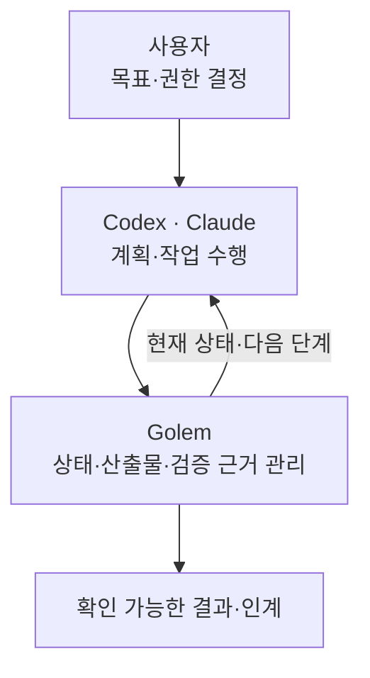
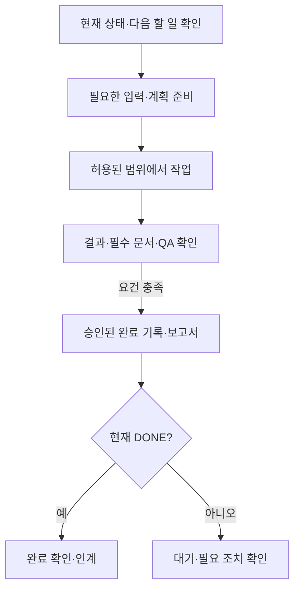
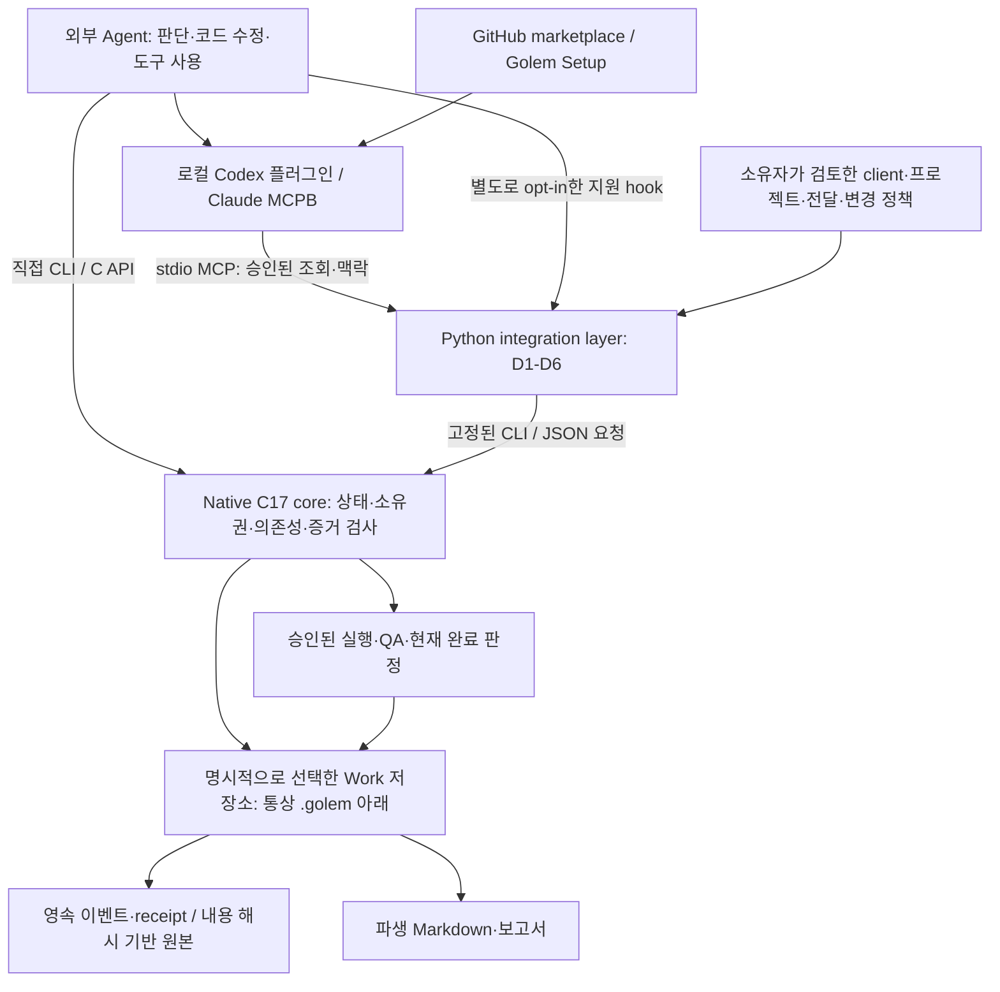

<!-- GOLEM_README_EDITING_RULES
README 편집 필수 규칙 — 사용자 명시 지시가 없는 한 이 형식을 유지한다.
1. 첫 화면은 최신 검증 상태 한 줄, 짧은 제품 소개, 역할·작업 흐름 Mermaid,
   짧은 MCP 설치 링크, 최소 문서 목록·라이선스 순서로 유지한다.
   workspace 진입 README는 짧은 소개·다이어그램·최신 안내 링크만 유지한다.
2. 기술·기능·버전 이력을 나열하지 않는다. 설치·사용 절차는 연결 문서에서 안내한다.
3. 업데이트 전에 본문과 연결된 Codex·Claude 설치 문서를 반드시 사전 검수한다.
   실제 검증 설치본·manifest·소스·현재 CLI와 대조해 구버전/중복 안내, 오래된 경로·명령,
   marketplace·연결 중복, 없는 adapter 실행, profile별 설정·권한 혼동을 찾아 정리한다.
   버전 숫자나 과거 PASS만으로 현재 검증을 주장하지 않는다. 과거 증거·원장은 보존한다.
4. 준비와 실행 승인을 구분하고 기존 권한을 유지한다. 필수 검증·문서 확인 후 승인된
   finalize/report를 처리하고 현재 completion_check로 DONE을 확인하는 흐름을 유지한다.
   불명확 결과·COMMIT_UNKNOWN을 재실행하거나 승인 pin을 임의 변경하도록 안내하지 않는다.
5. 한국어·영문 설명과 다이어그램을 함께 맞추고 링크·anchor·표현 중복을 검사한다.
   다이어그램 변경 시 모바일·데스크톱 및 라이트·다크 렌더링을 확인한다.
   실제 확인한 근거와 미실행 범위를 기록하고 검증되지 않은 내용을 최신 안내로 승격하지 않는다.
이 주석을 편집 과정에서 삭제하지 않는다. 사용자에게 보이는 README는 간결하게 유지한다.
-->

> 최신 MCP 검증본: **Codex 0.2.7 · Claude read 0.1.10** — 승인된 읽기 조회 검증 완료. [검증 범위](docs/mcp-m7-m8-validation.ko.md)

<div align="center">
  
</div>

<h1 align="center">Golem — Agentic Workflow Engine</h1>

<p align="center"><strong>AI가 수행한 작업을 상태와 검증 근거로 이어주는 엔진</strong></p>

**한국어** · [English](README.md) · [설치](#mcp) · [문서](#문서)

## Golem은 무엇을 하나요?

Codex·Claude가 계획하고 작업하면, Golem은 진행 상태와 산출물·검증 결과를 연결해 완료 조건을 확인합니다.

**자연어로 요청하면 됩니다.**

> “이 프로젝트의 로그인 오류를 수정하고, 테스트한 뒤 결과를 제출해줘.”

Codex·Claude가 요청을 해석해 필요한 Golem 도구를 선택하고, **도구가 요구하는 구조화된 인자는 agent가 조립합니다.** 로컬 정책 파일은 프롬프트 양식이 아니라 호출의 허용 범위를 정하는 설정입니다.

```text
사용자: 자연어 요청
    ↓
Codex·Claude: 작업 해석 → MCP 인자 구성
    ↓
Golem: 허용 범위·소유권·승인·최신성 검사
    ↓
실행 또는 부족한 입력·승인 안내
```

처음 프로젝트를 연결할 때 허용 범위를 설정하고, 이후에는 자연어로 사용합니다. 요청이 모호하면 agent가 질문하고, 추가 승인이 필요하면 승인을 요청합니다. **프롬프트 문구만으로 권한이 추가되지는 않습니다.** 현재 검증 연결은 세 조회만 허용하며, 위 수정·테스트·제출 예시는 해당 도구와 승인이 설정된 경우의 사용 방식입니다.



## 작업 흐름



완료 기록·보고서 처리 뒤 현재 완료 상태를 다시 조회합니다. 어느 단계든 승인 대기·오래된 입력·불명확한 결과가 있으면 중단하고 상태를 확인하며 자동 재실행하지 않습니다.

## MCP

사용할 client의 안내에 따라 검토한 패키지를 설치하고, 기존에 승인된 프로젝트·Work·action에 연결하세요.
설치만으로 접근·실행 권한이 생기지는 않습니다.


이미지는 검증한 합성 테스트 설치 사례이며, 설치만으로 권한이 생기지는 않습니다.

- **[Codex 설치·사용](docs/integration-codex-plugin.md)** — Golem Setup으로 연결하고 Golem Work로 진행합니다.
- **[Claude Desktop 설치·사용](docs/integration-mcpb.md#install-and-configure)** — 필요한 기능 패키지를 설치하고 연결을 확인합니다.

각 client에는 **검증된 Golem 최신본 한 개와 의도한 연결 한 개만** 유지합니다.

## 아키텍처

Agent는 판단하고 작업을 수행합니다. MCP 연동 계층은 허용 범위를 확인하고, native Core는 상태·소유권·승인·증거와 완료 조건을 검사합니다.



## 문서

| 필요한 안내 | 문서 |
| --- | --- |
| 전체 문서 | [전체 문서 색인](docs/README.md) |
| 작업 시작 | [Agent 설정](docs/agent-setup.ko.md) |
| 빌드·CLI | [런타임 안내](docs/runtime-reference.md) |
| 내부 구조 | [아키텍처](docs/architecture.md) |
| MCP 설계 | [연동 계약](docs/integration-layer-design.md) |
| 작업·완료 | [워크플로우](docs/workflow.md) |
| 작업·완료 | [완료 조건](docs/completion.md) |
| 권한·승인 | [승인 계약](docs/approvals.md) |
| 실행·증거 | [실행 경계](docs/execution-boundary.md) |
| 실행·증거 | [증거 검증](docs/evidence-verification.md) |
| 병렬·후보 | [Workspace](docs/workspaces.md) |
| 병렬·후보 | [후보 결과](docs/candidates.md) |
| 기능·검증 범위 | [MCP 기능 원장](docs/mcp-capability-inventory.ko.md) |
| 기능·검증 범위 | [실제 검증 기록](docs/mcp-m7-m8-validation.ko.md) |

## 라이선스

Copyright 2026 Donggyun Seo. **Source-available · [PolyForm Noncommercial 1.0.0](LICENSE)**.
비상업적 이용 범위와 조건은 원문을 따릅니다. [상용 이용](COMMERCIAL-LICENSE.md) · [고지](NOTICE)
