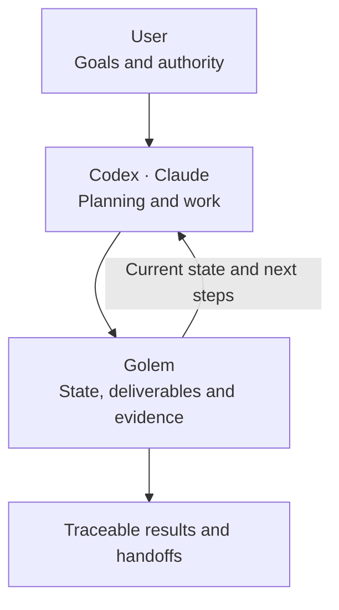
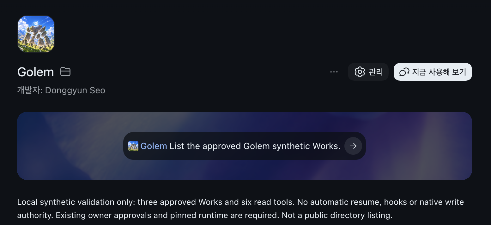
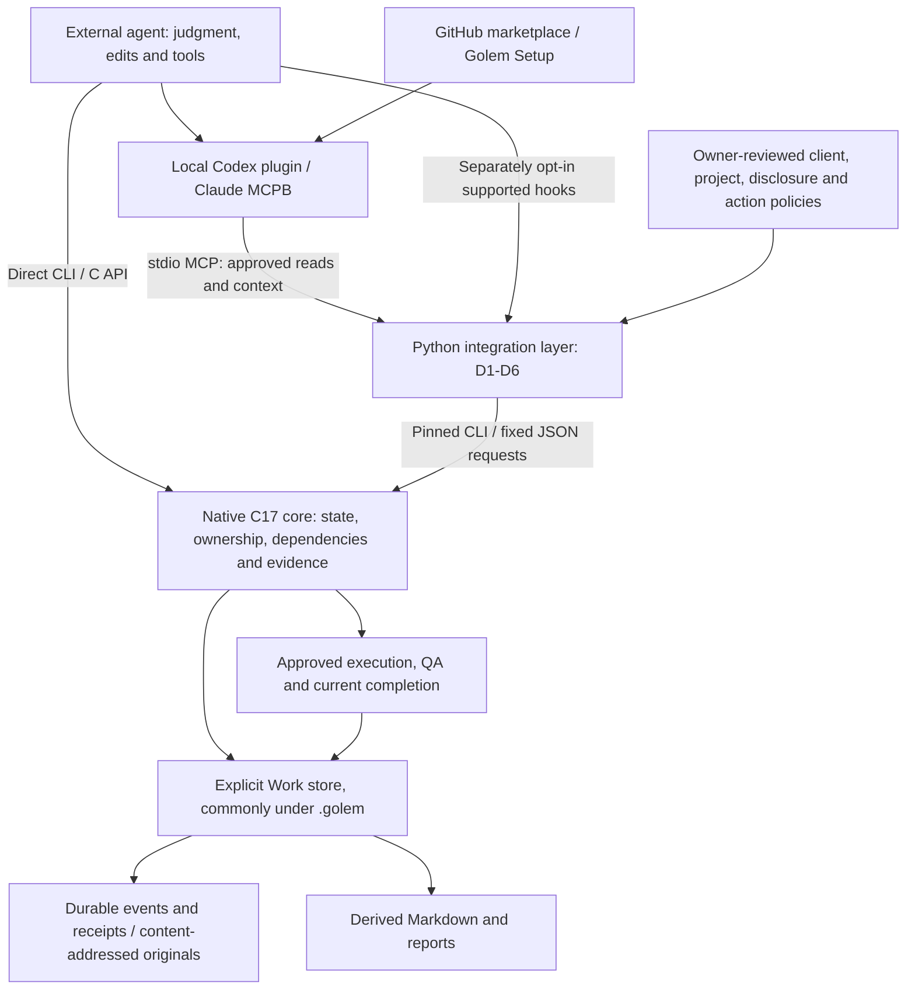

<!-- GOLEM_README_EDITING_RULES
Required README maintenance rules; preserve this format unless the user explicitly changes it.
1. Keep the visible order: one short latest verified status line, brief product introduction,
   Mermaid role/work flows, short MCP setup links, a small documentation table and license.
   The workspace entry README remains a brief introduction, diagram and guide links.
2. Keep technical inventories, feature lists and version history out of the README.
   Linked guides contain installation and usage steps.
3. BEFORE updating, review the README and linked Codex/Claude setup guides against verified
   installed files, manifests, source and the intended client's current CLI. Remove obsolete
   or duplicate instructions, paths, commands, marketplaces/connections, missing-adapter steps
   and profile/permission confusion. A version number or historical PASS is not current proof.
   Preserve historical evidence and ledgers instead of rewriting them as current verification.
4. Separate preparation from approval and preserve existing authority. Check required results,
   documents and QA; perform approved finalize/report actions; then read current completion_check
   for DONE. Never suggest replaying uncertain/COMMIT_UNKNOWN effects or rewriting approval pins.
5. Keep Korean/English text and diagrams aligned; check links, anchors and duplicate guidance.
   After diagram edits, check mobile/desktop and light/dark rendering. Record actual evidence
   and NOT_RUN scope; never promote unverified behavior into current installation guidance.
Keep this comment during editing. Keep the rendered README concise.
-->

> Latest verified MCP builds: **Codex 0.2.7 · Claude read 0.1.10** — approved read-only checks passed. [Verification scope](docs/mcp-m7-m8-validation.ko.md)

<div align="center">
  
</div>

<h1 align="center">Golem — Agentic Workflow Engine</h1>

<p align="center"><strong>Connect AI work through state and verification evidence</strong></p>

[](https://github.com/seadonggyun4/Golem/actions/workflows/c.yml)
[](CMakeLists.txt)
[](docs/conformance.md)
[](docs/agent-session.md)
[](LICENSE)

[한국어](README.ko.md) · **English** · [Setup](#mcp) · [Documentation](#documentation)

## What Does Golem Do?

Codex and Claude plan and perform tasks. Golem connects progress, deliverables and verification results to check completion conditions.

**Ask in natural language.**

> “Fix the login bug in this project, run the tests, and submit the results.”

Codex or Claude interprets your request, selects the Golem tools, and **assembles the structured arguments each tool requires.** The local policy file defines which calls are allowed; it is not a prompt template.

```text
User: natural-language request
    ↓
Codex / Claude: interpret the task → build MCP arguments
    ↓
Golem: check scope, ownership, approval and freshness
    ↓
Execution or a request for missing inputs or approval
```

Set the allowed scope when first connecting a project, then use natural language. The agent asks questions when the request is unclear and requests approval when needed. **Prompt wording alone never grants authority.** The current verified connections allow only three read tools; the fix/test/submit example requires the corresponding tools and approvals to be configured.



## MCP

Follow your client's guide to install a reviewed package and connect it to existing approved projects, Works and actions.
Installation itself grants no access or execution authority.



The image shows a verified synthetic test installation; installation itself grants no authority.

- **[Codex setup and use](docs/integration-codex-plugin.md)** — connect with Golem Setup and proceed with Golem Work.
- **[Claude Desktop setup and use](docs/integration-mcpb.md#install-and-configure)** — install the needed feature package and verify the connection.

Keep **one latest verified Golem installation and one intended connection per client**.

## Architecture

The agent plans and performs the work. The MCP integration checks the allowed scope, while the native Core checks state, ownership, approvals and evidence.



## Documentation

| Guide | Document |
| --- | --- |
| Documentation index | [All documents](docs/README.md) |
| Getting started | [Agent setup](docs/agent-setup.md) |
| Build and CLI | [Runtime guide](docs/runtime-reference.md) |
| Architecture | [Architecture](docs/architecture.md) |
| MCP design | [Integration contracts](docs/integration-layer-design.md) |
| Work and completion | [Workflow](docs/workflow.md) |
| Work and completion | [Completion](docs/completion.md) |
| Authority | [Approvals](docs/approvals.md) |
| Execution and evidence | [Execution boundary](docs/execution-boundary.md) |
| Execution and evidence | [Evidence verification](docs/evidence-verification.md) |
| Parallel work | [Workspaces](docs/workspaces.md) |
| Parallel work | [Candidates](docs/candidates.md) |
| Coverage and validation | [MCP inventory](docs/mcp-capability-inventory.ko.md) |
| Coverage and validation | [Client validation](docs/mcp-m7-m8-validation.ko.md) |

## License

Copyright 2026 Donggyun Seo. **Source-available · [PolyForm Noncommercial 1.0.0](LICENSE)**.
The license governs permitted noncommercial use. [Commercial use](COMMERCIAL-LICENSE.md) · [Notices](NOTICE)
