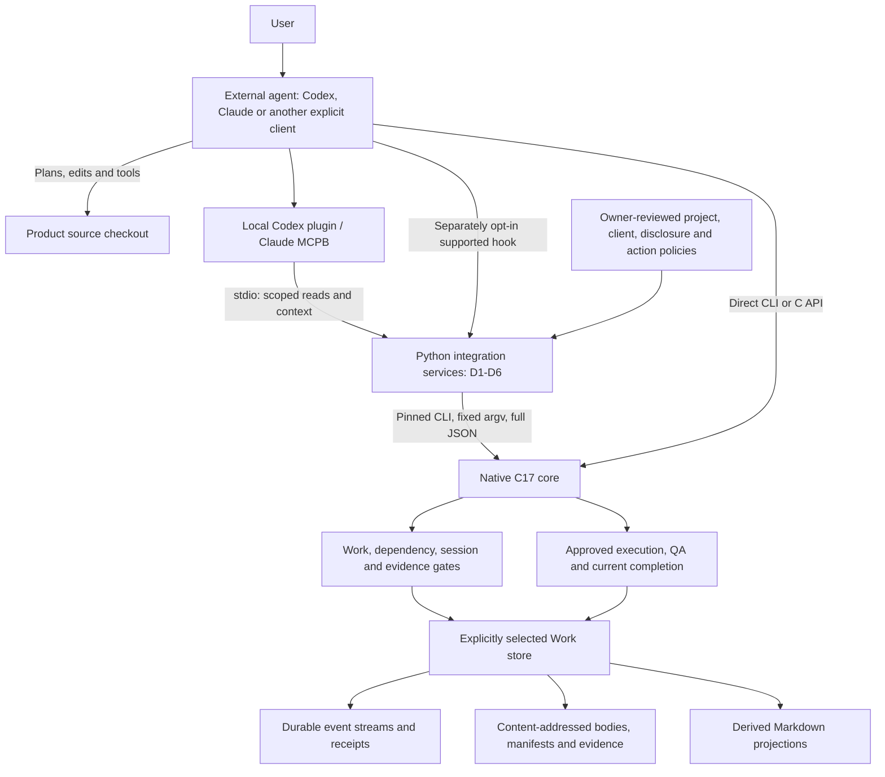
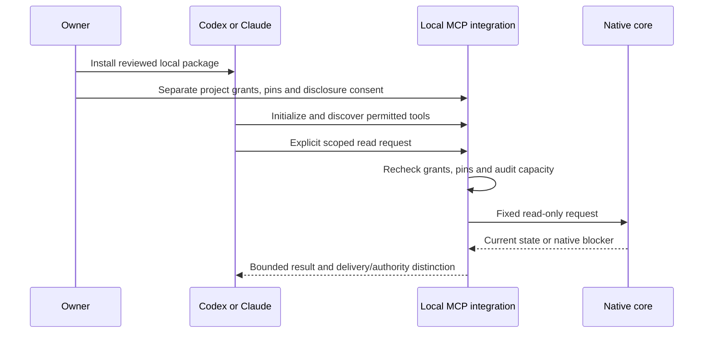
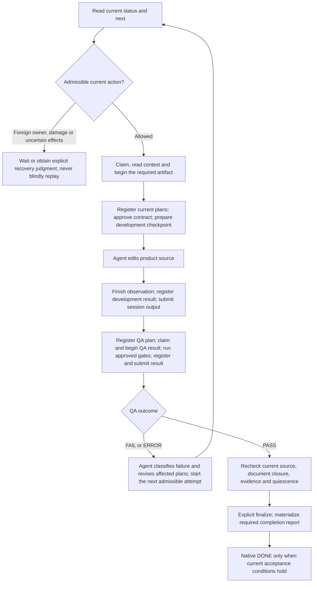

# Implemented Architecture and Work Process

The core implementation map was reviewed against `b5a7992` on 2026-10-22;
local client packaging was cross-checked against the `5aef1cd` source and the
owner-approved 0.1.3 desktop installations on 2026-10-24.
It describes existing behavior, not a deployment or migration plan.
Subsystem contracts linked below remain authoritative for exact schemas and
limits. Historical design snapshots and frozen evidence are not rewritten.

## Responsibilities

**AWE means Agentic Workflow Engine. Golem is the product.** An external agent
using the CLI/API is already a headless orchestration client. Golem need not
launch that agent or run a daemon to coordinate its work.

| Party | Owns | Does not imply |
| --- | --- | --- |
| Agent | Intent interpretation, planning, document authoring, code edits, tool use and judgments within user authority | Its assertion makes evidence true or establishes native DONE |
| Native core | Work state, dependencies, ownership, handoffs, evidence validation and configured acceptance predicates | Universal semantic understanding, authenticated authorship or defect-free product certification |
| Integration layer | Approved client/project mappings, scoped reads, explicit disclosure and typed native requests | A second workflow reducer, unrestricted filesystem access or automatic ownership transfer |
| Trusted host/owner | Reviewed policies, execution approval, executable pins, input delivery and client configuration | A hash, client label or model-supplied approval authenticates a human |

Approved local QA execution is compatible with this boundary. Optional provider
usage, research, observability and lifecycle adapters do not become required
paperwork for every ordinary Work. See [the responsibility contract](agent-golem-boundary.md).

## Layers and Entry Points

The native CLI is a thin facade over public C APIs. The current integration
backend launches that pinned CLI with fixed argument arrays, strict JSON,
bounded subprocess capture and a minimal environment; it is not a generic shell
dispatcher. D4's optional trusted approval host connects approved execution to
the existing native APIs. A future general C integration backend is not implied
by the public C API's existence.

Direct CLI/C callers are a distinct entry point: D1 grants do not mediate every
same-user process. Native gates still apply. Stronger adversarial isolation
requires an OS/host boundary, not just integration policy files.

The usual local MCP transport is a client-launched stdio process. Work handles
are opened for bounded operations, not held for the entire MCP connection.
The optional D6 network service is separate from an engine-owned agent daemon.
The optional CLI daemon's `local.noop` worker is simulation, not actual agent work.

### Local Client Packages

The [Codex plugin](integration-codex-plugin.md) references an existing reviewed
D1 launcher. The [Claude MCPB](integration-mcpb.md#install-and-configure) packages
unchanged D2 producer modules with a consent-checking entry adapter. Both reuse
the same scoped read contracts; they are not new workflow engines. Their icon
and developer metadata control presentation, not identity authentication.

Installation, startup, tool exposure, a successful call and UI rendering are
separate observations. The verified packages add no hooks, automatic Work resume
or native mutations. Local process access is not an OS sandbox. `AVAILABLE`
does not imply native completion or execution permission; a read can still
append private integration audit records. See the
[actual Codex desktop results](integration-codex-desktop.md#plugin-path-verification).

## Integration Responsibilities

| Layer | Implemented responsibility | Boundary |
| --- | --- | --- |
| [D1](integration-d1.md), [installer](integration-install.md) | Private approval registry; pinned project/client/Work identity; fixed read backend; reviewed managed client settings and empty bootstrap | No home-wide discovery, approval inferred from a root, unmanaged-setting replacement or existing-Work migration |
| [D2](integration-d2.md) | Read-only MCP; complete context candidates; explicit handoff preparation; scoped evidence read and current completion check | No native mutation, finalization, projection repair, arbitrary CAS/path read or proof of model consumption |
| [D3](integration-d3.md) | Opt-in startup/resume notices for supported client hooks, reusing D1/D2 | No automatic Work selection, claim, resume, heartbeat, reconciliation or execution |
| [D4](integration-d4.md) | Separately approved typed session/document actions and owner-approved QA through exact pinned native inputs | No model-selected paths, shell commands, identities, native approval flags or completion finalize tool |
| [D5](integration-d5.md) | Owner-only freeze, staged verification, enrollment-pin switch, reload probes and evidence-based quarantine handling | Not an auto-updater, universal runtime installer, forced client reload or replay of unknown effects |
| [D6](integration-d6.md) | Opt-in TLS MCP resource server; external-issuer JWT verification; scoped delegates, revocation and disclosure checks | Not an OAuth issuer, automatic Hosted setup, provider-token relay or relaxation of local/native approval |

These are composition boundaries, not six engines. D2 reads are reused by D4
and D6, and D3 reuses the approved reading path. D5 governs participating
integration callers; it cannot freeze every independent direct CLI/C caller.
Local cooperative identity and remote authentication have different assurance.
Actual Hosted-client activation remains distinct from local stdio/TLS testing.

## Storage and Authority

Work stores are commonly placed under a project's Git-ignored `.golem/`, but
their absolute paths are explicitly selected. Neither that directory name nor
its mere presence grants project access. No fixed `.golem` layout or relocation
of existing Works is required.

| Material | Role |
| --- | --- |
| Work specification and native event streams | Durable history replayed through existing versioned contracts and locks |
| CAS bodies, manifests and evidence | Exact content-addressed bytes; replay and domain checks bind their meaning |
| Receipts and registered revisions | Historical facts under their original contract; not automatically current acceptance |
| Markdown projections and reports | Derived readable output; not independent authority over immutable originals |
| Private integration registry and request records | Separate approvals, pins, observations, intents and uncertainty records outside native Works |
| Context/handoff delivery | Derived reading aid; not shared hidden reasoning, a new lease or proof that a model consumed it |

An updated parent revision can make downstream inputs STALE. A source edit can
invalidate earlier QA. Hash integrity is not content truth or authenticated
authorship. Reading a historical reference does not make it current.

`golem_evidence_read` permits only committed document manifest/body and journal
payload references from the approved Work record. It returns complete verified
bytes as base64 within its bound; it does not recursively treat arbitrary hashes
or prose as capabilities. `golem_completion_check` uses native read-only
`completion check`, not session resume, finalize or report materialization.
Reads may write private integration audit records, but never native Work data.
Derived projections are not freely editable authority: altered registered
projections and protected objects still fail their existing integrity checks.
Repair uses the explicit native procedure, not hand edits to original evidence.

## Representative Development Cycle

An owner first creates/enrolls a Work explicitly, establishes its scope and
registers the applicable selection. The diagram below starts with that existing
Work. It is a development path, not a universal sequence for every role contract.

Important ordering and scope:

1. `status`/`next` are observations, not permission to execute. `start` is an
   explicit session mutation when needed; D3 does not perform it automatically.
2. Each claim covers one required artifact, not every box in the diagram.
   Repeat claim/context/begin and document/session submission for each required
   kind. Session sequence and document generation are different counters.
3. In the standard stage-selection workflow, planning, development, QA and
   completion verification are not optional; UX/publishing depend on scope.
   Documents mode and separately enrolled role contracts retain their own
   predicates and do not fabricate code-execution evidence.
4. `prepare` pins the approved contract, input closure, executable digests,
   source baseline and protected objects before source edits. When a native
   session exists, prepare/finish and QA run require the appropriate RUNNING claim.
5. The agent edits source. `finish` observes it; `run` executes only approved QA
   gates. Registered schema-5 results reference issued execution receipts.
   Registration alone is neither semantic acceptance nor QA PASS.
6. A failure preserves history. The agent chooses the explanation and repair;
   native reentry contracts enforce applicable revisions and attempt limits.
   New code needs current evidence, not an old PASS relabeled as current.
7. Finalize is separate from querying completion. A durable current completion
   receipt and required materialized report permit DONE. Missing projections,
   active owners, unresolved effects or stale inputs retain the native blocker.

See [workflow](workflow.md), [sessions](agent-session.md),
[execution](execution.md), [reentry](reentry.md) and [completion](completion.md)
for exact commands and predicates. This diagram is not an executable plan.

## Handoff, Interruption and Updates

A receiving agent reads approved Work state, documents, evidence and explicit
judgment changes, not the sender's entire conversation or hidden reasoning.
D2 can prepare complete context and an explicitly addressed handoff; the host
must deliver it, and the receiver must independently reauthorize and reread.
Provider token-counted execution input uses the separate
[context-resume contract](context-resume.md), not an assumption that D2 delivery
has already consumed the input or granted execution.

Native status/next expose read-only `resume_preflight`, including boot changes,
clock rollback, lease and reconciliation needs even when active is null.
It does not perform the suggested operation. A live foreign owner cannot be
forcibly replaced; an interrupted RUNNING attempt with unclear effects cannot
be replayed automatically. Exact owner/sequence/token/input/source/binding and
protected-file checks remain authoritative. Current verified DONE stays DONE
across reboot; a historical receipt alone is insufficient.

D4 preserves a durable intent around dispatch. A lost reply or timeout may
leave COMMIT_UNKNOWN, not "no effects". D5's owner-reviewed quarantine procedure
examines existing evidence and never changes that historical uncertainty into
a successful execution or silently retries it. Updates require quiescence,
matching pins, explicit client reload review and compatible native observations;
no old Work is automatically migrated or downgraded.

## Code and Regression Map

| Claim in this overview | Implementation | Regression/contract |
| --- | --- | --- |
| State replay, read-only preflight and fenced transitions | [coordinator](../src/agent_session/coordinator.c) | [session integration](../tests/c/session_integration.py), [preflight gate](../tests/c/resume_preflight_gate.py) |
| Exact parent revisions and transitive freshness | [workflow](../src/workflow/model.c), [document registry](../src/document/registry.c) | [workflow contract](workflow.md), [document integration](../tests/c/document_integration.py) |
| Approved observed development/QA, not agent launch | [execution API](../include/golem/execution.h), [execution store](../src/execution/store.c) | [execution integration](../tests/c/execution_integration.py), [execution boundary](execution-boundary.md) |
| Current acceptance versus historical receipts | [completion store](../src/completion/store.c), [read-only CLI](../src/cli/completion.c) | [completion integration](../tests/c/completion_integration.py) |
| Fixed native backend, disclosure, scoped reads | [backend](../tools/integration_backend.py), [service](../tools/integration_service.py) | [D2 native/MCP gate](../tests/c/integration_d2_mcp.py) |
| Separate typed mutation and durable uncertainty | [mutation service](../tools/integration_mutations.py) | [D4 gate](../tests/c/integration_d4_mutations.py), [D5 gate](../tests/c/integration_d5_maintenance.py) |
| Optional authenticated remote reuse | [gateway](../tools/integration_gateway.py) | [D6 TLS/MCP gate](../tests/c/integration_d6_gateway.py) |

Supported runtime/integration mechanisms are scoped to macOS/Linux as described
in each contract. A static diagram is not Windows support, physical power-loss
qualification, actual Hosted activation or product certification. The same-UID
cooperative trust limits remain explicit. Neither diagrams nor documentation
updates modify native schemas, persisted evidence or existing Works.
