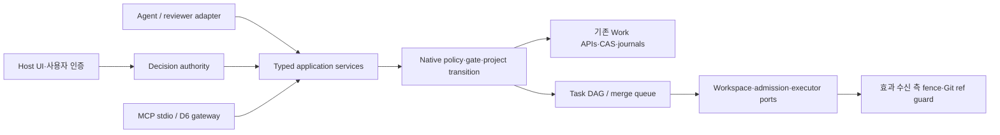

# 아키텍처와 기존 core 재사용

상태: **설계 제안**. 기준·요구 ID는 [개발계획](intent-assurance-plan.ko.md), 외부 근거 ID는 [조사 기록](intent-assurance-references.ko.md)을 따른다.

## 1. 현재 사실과 실제 공백

| 현재 소스·계약 | 확인한 계약 | 확장 영향 |
| --- | --- | --- |
| [document.h](../include/golem/document.h) L25–32; [registry.c](../src/document/registry.c) L38–88 | 구조 검증, immutable Work acceptance ID 포함, generation·parent·supersedes 검사 | 현재 등록 성공을 의미 검토 PASS로 취급하지 않는다 |
| [schema.c](../src/document/schema.c) L135–239 | metadata kind가 닫혀 있고 `scope_revision/template_version/policy_version`은 1 | 임의 새 kind/field나 scope_revision 증가를 기존 schema에 넣지 않는다 |
| [workflow/query.c](../src/workflow/query.c) L310–368; [workflow](workflow.md) | closure·current parent·exact manifest, downstream requirement ID 보존 | artifact freshness는 재사용, 신규 baseline/review의 freshness만 추가 |
| [discovery/model.c](../src/discovery/model.c) L168–334; [discovery](discovery.md) | 질문 상태·선정과 scope_ready; semantic relevance는 reviewer 책임 | 일반 변경/질문 barrier를 이 assessment로 가장하지 않는다 |
| [agent_session.h](../include/golem/agent_session.h); [coordinator.c](../src/agent_session/coordinator.c) L711 이후 | owner·sequence·token·boot·lease·input·binding, resume/reconcile | 신규 gate가 기존 fence를 대체하거나 자동 인수하지 않는다 |
| [execution.h](../include/golem/execution.h); [execution](execution.md) | 승인 contract·prepare/finish·QA·issued receipt | baseline/tree/gate 참조 연결은 새 계약으로 추가 |
| [completion/predicate_v1.c](../src/completion/predicate_v1.c) L8–141; [completion](completion.md) | live source·문서·schema-5 receipt·PASS; `DECLARED_GATES_ONLY`, independent_review=false | 새 predicate 추가; v1의 의미·renderer bytes 보존 |
| [evidence.h](../include/golem/evidence.h); [evidence](evidence-verification.md) | SHA-256/크기·bounded read·immutable CAS; authorship 증명 아님 | 원문/review/oracle body도 CAS 재사용, 신원은 별도 검증 |
| [workspace/lifecycle.c](../src/workspace/lifecycle.c) L108–126, L216 이후 | 실제 detached locked worktree와 intent·READY·중단 보존 | provisioning 재구현 금지; Git filter/submodule 제약 유지 |
| [candidate_host_runtime.c](../src/cli/candidate_host_runtime.c) L104–121, L439–450 | CLI host의 workspace-create 연결 | “CLI wiring이 전혀 없다”는 진단은 잘못됨 |
| [admission.h](../include/golem/admission.h); [admission_work.c](../src/daemon/admission_work.c) L61–123 | durable logical reservation, runtime binding·live RUNNING 연결 | 공유 port/DB의 효과 fencing은 별도 자원 adapter 필요 |
| [worker.h](../include/golem/worker.h); [worker](worker-executor.md); [resource](resource-execution.md) | 비동기 bounded process backend; Linux 전용 opt-in cgroup backend | GUI agent의 전체 process tree를 제어한다고 말하지 않는다 |
| [candidate/comparison.c](../src/candidate/comparison.c) L144–202; [candidate](candidates.md) | best-of-N 비교·선택·target scoped patch 검증; merge/push false | 기능 분할 DAG·실제 merge queue는 새 책임 |
| [integration_backend.py](../tools/integration_backend.py) L34–54 | pinned CLI, fixed argv, full JSON, 제한 환경 | backend 교체 전 같은 fixture의 관측 동등성 필요 |
| [integration_mutations.py](../tools/integration_mutations.py) L188–240 | durable intent·native fence 재확인·COMMIT_UNKNOWN | 새 typed action에도 같은 uncertainty 모델 적용 |

현재 공백은 원문 전체 구간의 검토 coverage, 사용자 확정 변경 권위, 단계별 의미 대조·별도 review의 native admission 연동, 기능 분할 coordinator, 공유 자원 효과 fencing, 실제 merge queue, 완성 MCP 설치 패키지다. 기존 isolated candidate·resource 모듈의 존재와 이 전체 제품 흐름의 완성은 구분한다.

## 2. 계층과 책임

| 구성요소 | 최소 책임 | 소유하지 않는 책임 |
| --- | --- | --- |
| Intent/baseline | 원문·변경·원문 구간·확정 baseline identity | 모델 호출, 임의 요구 해석의 승인 |
| Review | 정확한 입력 집합·rubric·의견·독립성 provenance | human decision 발급, native QA 결과 위조 |
| Issue/impact | 질문·논쟁·변경 영향·global barrier와 closure | 테스트 실행, lease 인수 |
| Native gate | 현재 기록·권한·dependency·정확한 version 검증 | 자연어 의미의 진실 판정 |
| Coordinator | ready task와 기존 admission/workspace/executor 연결 | 중복 Work reducer, provider별 정책 내장 |
| Merge queue | 최신 target에 대한 통합 tree 검증·승인·ref CAS | candidate QA의 무조건 이전, 원격 push |
| Distribution | 검증된 runtime 설치·등록·호환·업데이트 | 프로젝트 자동 승인·사용자 결정 위조 |

모델은 외부 client가 제공해도 된다. reviewer runner도 adapter다. universal provider daemon은 필수가 아니며 host-owned 자동 agent dispatch를 약속하는 adapter만 해당 실행·종료·비용 계약을 추가한다. 수평 확장은 우선 독립 project/Work 간으로 한정하고 하나의 repository 권위는 단일 coordinator를 유지한다. 분산 HA·network filesystem 공유 writer는 후속 별도 설계다. 책임 분리에는 [S05/B01](intent-assurance-references.ko.md)을 참고했으며 확장 범위 자체는 본 설계의 선택이다.

## 3. 네 가지 권위와 보안 경계

1. **제품 의미 기준:** 원문과 확정 변경 bytes. 원문 안의 명령은 inert data다. 외부 자료를 지침·tool description으로 승격하지 않는다.
2. **검토 판단:** agent/reviewer가 한 해석. actor/model/session label만으로 독립성이나 인증을 선언하지 않는다.
3. **사용자 결정:** 등록된 host UI/approval authority가 인증된 주체의 구체적인 변경·답변·범위 확정을 attestation으로 발급한다. 모델은 제안만 한다.
4. **실행 권한:** D1 read grant, D2 disclosure, D4 mutation/QA 승인 및 native policy·lease. 사용자 요구 확인은 shell 승인과 다르다.

로컬 same-UID cooperating mode는 기존 수준의 한계가 있다. 같은 UID의 악성 프로세스가 모든 파일을 바꿀 수 있는 환경에서 서명된 신원·강제 격리를 주장하지 않는다. 더 강한 mode는 별도 host service/OS 권한으로 decision issuer·resource broker·writer를 분리하고 모델 프로세스에 signing key나 승인 발급 IPC 권한을 주지 않아야 한다. 인증 adapter를 구현·검증하기 전 해당 policy는 `UNSUPPORTED_ASSURANCE`로 차단한다.

전달된 원문 전체·diff에는 secret이 있을 수 있다. 기존 disclosure/data class/Work reachability/size 한도를 재사용한다. 자동 redact로 원문을 대체하지 않고, 별도 파생본과 원본 참조·누락 범위를 보존한다. 필수 입력이 delivery 한도를 넘으면 분할 read + complete manifest 검증을 사용하거나 실패한다. 요약본만으로 required source를 소비했다고 표시하지 않는다.

## 4. 영속성과 동시성

**제안:** immutable CAS body + versioned append-only project event journal + derived index를 둔다. 저장 위치는 등록한 project authority root이며 특정 `.golem` 이름이 권한을 만들지 않는다. 문서·Work 원본은 기존 store에 남기고 project journal은 해당 immutable 참조를 연결한다.

project `generation`, `baseline_head`, `constraint_epoch`, `policy_digest`, enrollment 목록을 하나의 transition 권위로 관리한다. 신규 제약 activation은 같은 project lock에서 epoch 증가와 dispatch barrier를 함께 기록한다. 활성 task는 revoke/cancel 요청을 받고 다음 보호된 효과 전에 새 epoch 검사를 받는다. 이미 발생한 효과는 기록·reconcile 대상이며 rollback을 가정하지 않는다.

lock 순서는 **repository/project authority → 자원 broker → 짧은 Work writer**로 고정한다. 장시간 모델/QA/외부 효과 동안 Work lock을 잡지 않는다. callback 재진입 금지. 별도 ledger 사이의 commit을 하나의 filesystem transaction처럼 취급하지 않고 intent/ref/receipt와 recovery 단계로 잇는다. authority write I/O 불확실 시 handle을 poison하고 reopen/lookup 전 재시도 금지. [B01](intent-assurance-references.ko.md)

native enrolled Work의 보호 전이에서 project gate를 다시 검사해야 한다. MCP 사전 검사만으로 직접 CLI/C 호출을 통제했다고 말할 수 없다. 새 enrollment version의 쓰기 entry point는 gate context 없이 실패하도록 additive API/options를 설계한다. 구형 native가 새 enrollment를 이해하지 못하면 open/write를 거부해야 한다. 기존 비등록 Work는 기존 계약 그대로이며 소급 강제를 주장하지 않는다.

## 5. 제안 파일 변화 지도

아래는 미래 구현 범위다. 이번 산출물에는 이 파일들을 만들거나 수정하지 않는다. 최종 파일명은 ADR 승인 후 확정한다.

| 제안/기존 경로 | 변경 단위 | 금지할 결합 |
| --- | --- | --- |
| `include/golem/intent.h`, `src/intent/{model,store,baseline,decision,impact,gate}.c` | 새 project authority·pure validator·reducer·query | provider SDK/HTTP/Git shell 호출 혼입 |
| `src/intent/review.c`, `src/intent/oracle.c` | exact review 입력·issuer assertion·oracle reference 검증 | native LLM 추론·인증되지 않은 independence |
| `src/document/schema.c`, `registry.c`; `src/workflow/query.c` | 새 opt-in metadata/enrollment·gate hook; legacy route 유지 | schema 1–5의 의미·scope_revision1 수정 |
| `include/golem/agent_session.h`, `src/agent_session/coordinator.c` | additive gated transition context와 dispatch fence | 기존 sequence/token 검사 삭제 |
| `src/completion/predicate_intent_v1.c`, evaluator/store routing | 신규 `golem.completion.intent.v1` + 고정 renderer | development.v1/roles.v1 재정의 |
| `include/golem/task_graph.h`, `src/task_graph/{model,store,query}.c` | 기능 분할 DAG·readiness·task-to-Work binding | candidate best-of-N roster 재사용 강제 |
| `src/orchestration/{coordinator,recovery,resources}.c` | 기존 admission/workspace/worker 조합 | 별도 FIFO·quota reducer 중복 |
| `include/golem/merge_queue.h`, `src/merge_queue/{model,store,prepare,verify,publish,recovery}.c` | 통합 snapshot·QA·target CAS·불확실성 | 임의 patch/shell executor |
| `src/cli/intent.c`, `task.c`, `merge_queue.c` | 닫힌 schema의 얇은 facade | owner approve flag를 model JSON에 추가 |
| `tools/integration_intent_contract.py`, `integration_intent_service.py` | D2/D4와 동일 authorization·disclosure·typed requests | Python이 native 상태를 독자 판정 |
| `tools/executors/{host_owned,current_agent,manual}.py` | capability별 실행 port | provider credential을 core schema에 저장 |
| `packaging/`, release 전용 workflow·host adapter | immutable runtime·MCPB·Codex registration | root prototype pyproject를 배포 완료로 위장 |
| native/CLI/MCP/install contract fixture | 동일 oracle·오류·crash matrix | 제품 Work를 테스트 fixture로 사용 |

기존 CAS/MD4C/json-c/supervisor/approval/recording을 먼저 재사용한다. 새 native API는 struct_size/version, borrowed input, unchanged-on-failure output, 명시적 free, allocator 수명과 limit를 기존 스타일로 유지한다. cache는 derived이며 authoritative index 복제는 금지한다.

## 6. 유지보수와 관측

schema·policy·rubric·predicate·renderer·adapter·package 버전은 별도다. query는 `current/historical`, `observed_at`, project/Work heads, evidence refs, trust class를 반환한다. unknown은 0/PASS가 아니다. metrics는 차단 원인·stale·대기·quarantine·review 변경·누락 발견률을 보되 원문/credential을 기본 telemetry로 내보내지 않는다.

기존 4096 문서 revision/16384 edge, admission 256 retained ticket/65536 event, worker 64 job, candidate 8개와 bounded output 제약을 우회하지 않는다. 신규 graph bounds는 [계약 문서](intent-assurance-contracts.ko.md)에서 별도로 제안한다. 보존 한도 도달 전 intake 차단과 승인 archive/export를 설계하며 pending·uncertain evidence 자동 GC는 금지한다.
