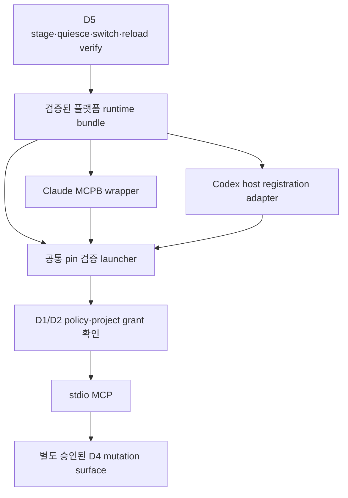

# Clone/CMake 없는 MCP 설치·배포 설계

상태: **배포 구현 전 제안**. 설치·클라이언트 활성화·공식 디렉터리 등재·프로토콜 호환은 서로 다른 검증 항목이다. [개발계획](intent-assurance-plan.ko.md)의 IA-R11/R12를 구현하는 책임 경계다.

## 1. 현재 사실

루트 [pyproject.toml](../pyproject.toml) L8–20은 historical Python prototype과 `golem-prototype` entry point다. 지원 native runtime의 MCP 배포 패키지가 아니다. [CMakeLists.txt](../CMakeLists.txt) L291–313은 native CLI/Linux helper/선택 approval host의 install target을 제공한다. [Conan recipe](../conanfile.py), [설치 도구](../tools/install_conan_cli.py)는 이미 만든 native package를 배치할 수 있다.

[D1 installer](integration-install.md)는 관리형 client 설정을 보존하며 plan/apply/remove·backup·부분 실패 처리를 제공한다. 기존 Python/runtime/SDK/transfer policy pin을 입력받는다. [integration_launch.py](../tools/integration_launch.py) L17–29는 runtime·producer·managed config를 재검사한다. [D5](integration-d5.md)는 freeze/stage/verify/pin switch/reload probe/recovery를 제공한다. 이것들은 자동으로 완성 runtime을 배포하는 기능이 아니다.

`tools/requirements-mcp.txt`의 직접 MCP package pin과 D5 interpreter pin은 전체 transitive dependency·publisher authenticity 검증을 대신하지 않는다. 현재의 실제 SDK 호환 경로는 고정 `mcp==2.3.0`, `mcp-types==2.3.0`이며 최신 명세나 새 host 기능을 읽었다고 자동 업그레이드하지 않는다.

## 2. 사용자 흐름과 배포 단위

목표 사용자 흐름: **플랫폼에 맞는 Golem 패키지 설치 → host 연결/등록 → 프로젝트·읽기/전달 범위 검토 → 필요한 변경/실행 승인 → 사용**. Golem 자체를 쓰기 위해 repo clone, compiler, CMake, Conan, system Python 또는 `pip install`을 요구하지 않는 패키지를 기준으로 한다. 사용자 제품의 QA가 별도 toolchain을 요구하는 것은 구분한다.

권고 배포 구조는 native launcher가 embedded Python runtime과 검증된 integration package를 시작하는 self-contained bundle이다. Python 구현은 유지하고 core를 Python으로 재작성하지 않는다. native dependency의 정적/동적 bundling·라이선스·보안 업데이트 비용은 ADR-D05에서 확정한다.

```text
golem-runtime/<platform>/<immutable-package-id>/
  bin/golem-launcher
  native/golem
  native/golem-integration-host
  native/golem-cgroup-exec              # 검증된 Linux artifact에만 포함
  python/                             # 재배치 가능한 정확한 runtime
  integration/                        # 기존 D1–D6 + 새 typed adapter
  dependencies/                       # runtime 동적 라이브러리 포함 여부 명시
  manifests/runtime.json
  manifests/dependencies.json
  licenses/
```

이 layout은 제안이며 사용자 절대경로·개인 policy·Work·credential을 release에 포함하지 않는다. runtime은 immutable destination에 설치하고 project data·audit·cache·decision authority와 분리한다. launcher는 bundle root identity/manifest/signature·pins를 검증하고 current directory/PATH/PYTHONPATH/사용자 site-packages로 executable/import root를 바꾸지 못한다. 자식 환경은 allowlist이며 stdout은 MCP protocol 전용, 진단은 bounded stderr/승인 audit로 분리한다.

## 3. Host별 installation adapter



| Adapter | 설치 artifact·등록 | 보증하지 않는 것 |
| --- | --- | --- |
| Claude Desktop MCPB | platform bundle을 감싼 `.mcpb`, 검증된 manifest profile·launcher entry | MCPB 설치가 프로젝트 grant·human approval·Windows native 지원을 만들지 않음 |
| Codex host | 검증된 local launcher를 host의 MCP 설정/UI에 등록; 기존 D1 lossless installer 재사용 | Claude MCPB를 Codex가 같은 방식으로 설치한다는 가정 없음 |
| Claude Code | 기존 project `.mcp.json` 관리 profile을 adapter로 유지 | Desktop과 같은 hook/trust/설정 우선순위를 가정하지 않음 |
| Remote/Hosted | 선택 D6와 별도 issuer·TLS·delegate/disclosure 설정 | local 설치만으로 cloud 접근/Hosted 활성화되지 않음 |

MCPB 공식 manifest에서 `binary`는 dependency를 포함한 executable 경로를 지원한다. 이 특성을 이용하는 binary launcher wrapper를 우선 검토하되 실제 host에서 embedded Python/native payload를 찾고 재배치·codesign 조건을 만족하는지 검증한다. 조사 당시 문서 상단은 manifest 0.3으로 표기하면서 uv 항목은 0.4+로 설명하므로 “main의 최신 예시”를 곧바로 지원 profile로 삼지 않는다. release마다 manifest schema commit·builder version·최소 host 버전을 고정한다. dependency의 host-side 자동 설치가 필요한 uv 경로는 초기 완성/offline bundle의 기본으로 채택하지 않는다. [S08](intent-assurance-references.ko.md)

Codex 공식 안내는 local STDIO/Streamable HTTP와 host 설정을 구분한다. local registration adapter는 owner가 선택한 scope의 config만 관리하며 default 경로 자동 탐색이나 managed enterprise policy 우회를 하지 않는다. host 등록 API/CLI를 사용하면 기존 승인 scope·보존 의미가 D1 installer와 같은지 검증하고, 검증 전에는 “자동 등록 지원”으로 표시하지 않는다. [S09](intent-assurance-references.ko.md)

MCP server protocol 지원, 패키지 설치 성공, host connection, tool 노출, source 전달, native mutation, 사용자 수용을 각각 관측한다. `installed:true`를 `activated:true` 또는 `accepted:true`로 변환하지 않는다. 공개 MCP registry/Claude directory 심사와 서명·보안 요구는 별도의 유통 절차이며 protocol conformance와 동일하지 않다. 등록 심사·자동 업데이트·모든 host 지원은 현재 미구현/미검증이다.

## 4. 플랫폼·호환 manifest

권고 최초 qualification은 macOS arm64와 Linux x86_64 local native 경로다. 이는 출시 지원 확정이 아니며 artifact가 실제 통과한 platform/OS/libc/filesystem/host 조합만 지원표에 추가한다. macOS x86_64/Linux arm64는 별도 pipeline·fixture가 필요하다. Windows native는 현재 보장하지 않고 원격 Linux delegate 사용도 별도 qualification이다. Claude Desktop의 지원 OS와 native runtime artifact의 OS를 혼동하지 않는다.

제안 runtime manifest:

```json
{
  "schema": "golem.runtime-package.v1",
  "package_id": "demo-darwin-arm64-001",
  "platform": {"os": "darwin", "arch": "arm64", "minimum_os": "TBD"},
  "native_version": "TBD",
  "native_digest": "aaaaaaaaaaaaaaaaaaaaaaaaaaaaaaaaaaaaaaaaaaaaaaaaaaaaaaaaaaaaaaaa",
  "integration_schema": "golem.integration.v1",
  "python_runtime": {"version": "TBD", "inventory_digest": "bbbbbbbbbbbbbbbbbbbbbbbbbbbbbbbbbbbbbbbbbbbbbbbbbbbbbbbbbbbbbbbb"},
  "dependency_lock_digest": "cccccccccccccccccccccccccccccccccccccccccccccccccccccccccccccccc",
  "readable_contracts": ["legacy-profile-TBD", "golem.intent.baseline.v1"],
  "writable_contracts": ["golem.intent.enrollment.v1"],
  "protocol_profiles": ["qualified-profile-TBD"],
  "host_profiles": ["qualified-host-profile-TBD"],
  "source_provenance_ref": "release-build-attestation-TBD"
}
```

TBD는 열린 결정이며 실제 release validator는 이를 거부해야 한다. manifest 자체를 self-trusted로 쓰지 않고 package inventory·서명 metadata·신뢰 root와 연결한다. protocol profile, native evidence schema, C ABI, Python adapter, host config와 package version은 서로 독립이다. 읽기는 지원하지만 쓰기는 미지원인 조합을 구분하고, unknown schema에 permissive fallback하지 않는다.

## 5. 경쟁 설치·권위 충돌 방지

여러 설치 경로가 같은 Work를 발견해 각자 coordinator를 초기화하면 안 된다. project enrollment는 canonical repository identity(등록 ID·device/inode·Git common-dir identity), authority root identity/namespace, 지원 writer contract, runtime pin을 고정한다. 복제 repo·복사 Work·symlink·이동은 자동 재신뢰하지 않는다.

프로젝트당 단일 admission/project authority owner lock을 공유하고 wrapper별 별도 namespace를 만들지 않는다. 다른 package가 접근하면 compatible read만 허용하거나 `AUTHORITY_CONFLICT/PIN_MISMATCH`로 멈춘다. 전역 latest 설치가 project pin을 바꾸지 않는다. launcher alias 변경도 D5의 명시 switch 대상이다. 직접 구형 CLI가 새 enrollment를 열지 못하도록 native version guard를 검증한다. 같은 UID malicious bypass 방지는 별도 OS boundary의 조건이며 단순 config lock으로 해결됐다고 말하지 않는다.

Python cache와 host connection state는 disposable이다. cache를 삭제해도 registry/native authoritative heads에서 복구하며 cached grant·gate·baseline으로 mutation을 허가하지 않는다.

## 6. Release pipeline와 신뢰

미래 pipeline: source revision/dirty rejection → locked dependencies·compiler/toolchain → platform build → native/CLI/MCP fixture → package inventory/license/SBOM → package signature/provenance → clean-machine installation → 실제 host qualification → signed release metadata publication. **이번 문서 작성에서는 실행하지 않는다.**

hash는 bytes identity다. publisher 검증은 별도 신뢰 root·signature policy·key rotation/revocation을 요구한다. auto update를 제공한다면 TUF의 역할 분리·만료·버전/rollback/freeze 방어를 적용할지 ADR-D06에서 결정하고, 적용 전 TUF 준수라고 쓰지 않는다. OS codesign/notarization도 package integrity·project authority·schema migration을 대신하지 않는다. [S10](intent-assurance-references.ko.md)

dependency lock은 transitive exact version·hash·source origin·license를 포함한다. offline bundle이 불가능한 platform/host는 설치 중 network/download·검증·실패 동작을 사용자에게 명시하고 IA-R11의 완성 패키지 수용 기준을 다시 승인받는다. 설치 중 compiler/system Python에 조용히 fallback하지 않는다.

## 7. D5 update·migration·rollback

`CHECK → STAGE_IMMUTABLE → VERIFY_SIGNATURE_AND_COMPATIBILITY → QUIESCE → OWNER_APPROVE → SWITCH_PINS → HOST_RELOAD → READ_ONLY_VERIFY`를 기존 D5 operation으로 잇는다. running claim/worker/merge intent·unknown 효과가 있으면 switch 보류다. 모든 참여 host의 reload 확인을 모의 SDK probe와 구분한다.

새 runtime은 현재 Work·baseline·journal의 reader/writer schema를 검사한다. migration 필요 시 [ADR-M01](intent-assurance-contracts.ko.md)의 explicit plan·backup/immutable refs·side-by-side 검증을 별도 수행한다. runtime upgrade와 schema write를 한 “업데이트 성공”으로 묶지 않는다.

새 event/effect가 없는 실패는 원래 pin·immutable runtime으로 승인 복귀할 수 있다. 새 schema event나 외부 효과 이후에는 무조건 이전 binary로 돌아가지 않고 compatibility·복구 판단을 한다. signature metadata rollback 방어와 데이터 schema rollback 가능성은 다른 문제다. uninstall은 관리 host entry/runtime 참조만 제거하고 Work·source·decision·unknown effect evidence는 삭제하지 않는다. D1 partial apply·D5 quarantine 기록을 보존한다.

## 8. 설치·운영 수용 기준

- compiler/CMake/Conan/system Python 없는 깨끗한 계정에서 설치·stdio 연결·approved synthetic Work read까지 완료한다.
- package를 공백/비ASCII 경로로 옮겨도 검증된 relocation 방식만 사용하며 import/PATH injection을 거부한다.
- MCPB와 Codex registration에서 기존 client 설정·주석·hook 보존과 제거 복원을 확인한다.
- 설치→등록→reload→실제 tool 호출→native evidence를 각 단계별로 기록한다. mock만으로 actual host 지원을 발표하지 않는다.
- stale/변조/폐기 signature, expiry/clock 불확실, dependency tamper, unsupported OS/ABI/schema를 거부한다.
- 두 bundle/launcher가 같은 Work를 동시 writer로 열면 하나만 권위를 갖거나 둘 다 명시적 충돌로 멈춘다.
- update 중 crash·disk full·old host 잔존·새 event 이후 downgrade를 [실패 주입 행렬](intent-assurance-delivery.ko.md)의 A21–A27로 검증한다.

운영 문서에는 지원 조합·한도·남은 미검증·source disclosure 범위·실행 권한을 표시한다. 이 설계만으로 사용자 비용 절감·병렬 속도 향상·실제 Hosted activation을 주장하지 않는다.
