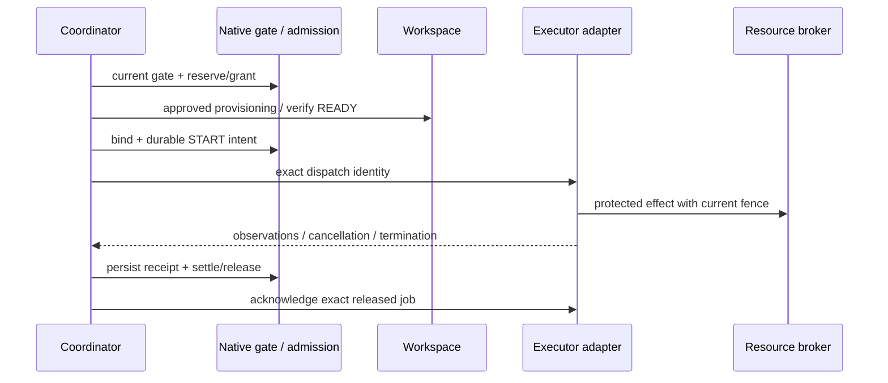

# 기능 분할 병렬 실행과 merge queue

상태: **구현 제안**. 현재 기반은 [workspace](workspaces.md), [admission](admission.md), [worker](worker-executor.md), [candidate host](candidate-host.md), [candidate review](candidate-diff.md)다. 새 protocol 이름·상태·API는 현 구현이 아니다. 원문 gate는 [데이터 계약](intent-assurance-contracts.ko.md)을 따른다.

## 1. 보존할 현재 사실

[workspace/lifecycle.c](../src/workspace/lifecycle.c) L108–126은 실제 detached locked worktree를 만든다. host가 repository admission과 termination 증명을 제공해야 하며 main dirty 변경을 복사·stash·reset·merge하지 않는다. [candidate_host_runtime.c](../src/cli/candidate_host_runtime.c) L439–450에 CLI workspace-create 연결이 있다.

[admission](admission.md)은 global namespace 내 Work writer/session lane·slot/CPU/memory를 예약하고, RUNNING 불확실성을 restart 뒤에도 보존한다. logical quota는 OS isolation이 아니다. [worker.h](../include/golem/worker.h) L55 이후의 bounded pool은 host-owned process용이며 current-agent가 자동 등록되지는 않는다. [resource](resource-execution.md)는 Linux 전용 opt-in cgroup v2이며 모든 플랫폼의 GUI agent를 제한하지 않는다.

[candidate/comparison.c](../src/candidate/comparison.c) L144–202는 같은 base·gate/environment의 선택 candidate와 target QA 및 정확한 policy-scoped 변경 동등성을 검사한다. merge/push는 false다. 이 API를 수정 없이 최신 target 통합 검증으로 사용할 수 없다.

## 2. best-of-N과 기능 분할 DAG

| 구분 | 기존 candidate | 신규 task coordination DAG |
| --- | --- | --- |
| 목적 | 같은 task의 대안 구현 비교 | 서로 다른 의무를 구현하고 통합 |
| 합성 | 하나의 후보를 명시 선택 | 의존 선후행에 따라 여러 결과 통합 |
| QA | common oracle/environment/base의 비교 가능성 | task별 oracle + 통합 tree의 cross-task oracle |
| budget | 후보 group의 예약·누적 usage | task-to-Work의 예약·공유 자원·변경 영향 |
| 재시도 | 별도 candidate/group | task attempt·새 Work mapping/준비; 불명 효과 재실행 금지 |

task node는 stable task ID, immutable spec digest, baseline/requirement/source span refs, Work/selection refs, dependency type, expected deliverable interface, source base, allowed effect domains, resource demand, executor capabilities, reviewer/oracle policy를 가진다. 파일 영역이 다르다는 이유만으로 독립이라고 보지 않는다. API·DB schema·공통 test oracle·port·cache·외부 시스템도 분해 경계에 포함한다. [B03](intent-assurance-references.ko.md)

coordination state는 별도 product completion 진실이 아니다. `WAITING_INPUT`, `BLOCKED`, `READY`, `RESERVED`, `PROVISIONING`, `RUNNING`, `RESULT_OBSERVED`, `INTEGRATION_PENDING`, `INTEGRATED`, `QUARANTINED`는 실행 조정 상태다. Work의 current workflow/completion과 baseline/gate를 매번 합성한다. `INTEGRATED`도 project 전체 DONE을 뜻하지 않는다.

task input revision/소스 변경 → task gate stale → 해당 dependent task와 merge item stale 순서로 전파한다. document 변경은 기존 document DAG reducer가 먼저 판정하고 coordinator가 그 결과를 참조한다. project baseline 변경은 trace 없는 node까지 영향 평가한다. graph cycle·중복 node·교차 repository 무등록 edge·missing Work는 fail closed다.

### Typed edge와 충족 증거

각 edge는 `edge_id`, `predecessor_task`, `successor_task`, `type`, `predecessor_spec_digest`, `selected_attempt_ref`, `required_artifact_refs`, `evidence_policy_digest`, `consumption_mode`, `baseline_digest`를 고정한다. `selected_attempt_ref`가 미정이면 edge는 미충족이며 새 attempt 채택은 명시적 edge revision으로 기록한다. policy가 요구하는 artifact kind·predicate version·review/QA 및 target 참조를 `evidence_policy_digest`가 가리키는 불변 정의에 열거한다. “가장 최근 성공한 결과”를 임의 선택하지 않는다. 모든 incoming required edge는 AND 조건이다. 암묵적 OR·fail-open·실패시 edge 삭제는 없으며 조건부 생략은 별도 승인된 task spec revision과 영향 검토가 필요하다.

| Edge type | readiness를 여는 required current evidence | 허용 범위·금지 |
| --- | --- | --- |
| `ARTIFACT_OBSERVED` | 정확한 predecessor task/spec/선택 attempt의 immutable result-observation receipt, 요구 artifact bytes·CAS/ref 무결성, 승인된 provenance, current baseline/epoch. observation 자체의 오류·누락이 없어야 함 | `consumption_mode:EXPLORATORY`인 조사/비교/초안 입력만 연다. 선행 code QA 수락·완료를 뜻하지 않으며 제품 구현/accepted publish의 QA 의무를 대체하지 못함 |
| `QA_ACCEPTED` | 위 exact artifact identity + predecessor Work의 현재 input/document closure, 그 소스·gate·environment의 issued PASS QA와 등록된 결과·session submit, 요구된 semantic review, blocking obligation 없음. native가 현재 source/receipt를 다시 검사 | 해당 artifact를 제품 task 입력으로 소비할 수 있다. target 통합을 가정하지 않으며 “main에 이미 있음”이 필요한 edge에는 불충분. policy가 Work 전체 완료를 요구하면 해당 current completion 증거도 필요 |
| `INTEGRATION_ACCEPTED` | 위 task/QA/review identity + 그 변경을 포함한 COMMITTED publication receipt, 정확한 integration snapshot 및 current target applicability 검증. live ref OID와 broker version 검증은 §9를 따른다 | target에 통합된 결과가 필요한 후속 작업만 연다. 과거 merge receipt·ancestor 관계·patch-id만으로는 미충족. 후속 task source base는 검증된 target identity를 고정 |

어느 edge가 충족돼도 successor의 own Work workflow, 원문 review·질문 gate·권한·자원·세션 입력 검사까지 통과해야 READY다. query의 충족 관측은 허가가 아니며 reserve/start·protected publish 때 같은 edge/증거 tuple을 재평가한다. 선행 결과의 source/attempt/target이 변하면 소비 manifest도 stale이다. `ARTIFACT_OBSERVED`의 탐색 자료를 accepted 제품 입력으로 승격하려면 `QA_ACCEPTED` 이상의 새 edge policy와 필요한 증거가 있어야 한다.

| 선행/graph 상황 | edge/readiness 처리 | 후속·실행 중 작업 처리 |
| --- | --- | --- |
| 증거 대기·missing artifact | `WAITING_INPUT`, 해당 edge 미충족 | 승인된 read/조사만 가능; dependent product start 금지 |
| FAILED/ERROR 또는 요구 QA FAIL | `PREDECESSOR_FAILED`; 수락/통합 edge 미충족 | 실패 관측은 별도 탐색 task에만 전달 가능. 제품 successor는 차단하고 새 시도·spec revision 검토 |
| CANCEL_REQUESTED/CANCELLED | 새 product consumer 차단; 종료/불확실 효과를 별도 확인 | 이미 실행 중인 dependent의 protected publish/merge를 fence하고 영향 평가. 취소가 무관 task 전체 자동 취소는 아님 |
| STALE/SUPERSEDED·baseline/epoch/선택 attempt 변경 | 기존 edge satisfaction snapshot 무효, 새 current 증거 필요 | affected closure와 실행 중 dependent의 publish/merge fence; 역사 관측 보존 |
| START_INTENT/termination/외부 효과 불확실 | `RECOVERY_REQUIRED`; QA/통합 수락 edge 열지 않음 | quarantine/reservation 유지, 명시 reconcile 전 redispatch 금지 |
| cycle·self edge·없는 node·지원하지 않는 edge type | graph revision 전체 거부; 부분 활성화/예약 없음 | 기존 승인 graph는 유지하되 새 변경의 barrier는 별도 유지 |

실패·취소 관측을 분석하는 탐색 task는 원래 제품 edge를 약화하는 대신 별도 typed task/edge로 정의한다. 이미 수락된 산출물과 이후 취소의 관계도 자동 소거하지 않고 적용 범위를 평가한다. 현재 edge의 native 검사 결과만이 readiness 근거이며 Python cache나 독립 task DONE 필드는 권위가 아니다.

## 3. 조정 상태와 commit 경계

| 전이 | 필수 조건 | 중단/실패 |
| --- | --- | --- |
| WAITING_INPUT → READY | 기존 Work next/문서 입력 current + raw-source review + task parent 의무 충족 | 미판별 질문/영향이면 BLOCKED |
| READY → RESERVED | 단일 repository admission owner, 정확한 resource/Work/runtime binding | quota 부족은 queue, over-total은 거부 |
| RESERVED → PROVISIONING | 승인된 full base OID·등록 repository/root, provisioning intent | partial worktree는 ATTENTION; CREATE 재실행 금지 |
| PROVISIONING → RUNNING | workspace READY·fresh host permission·current gate·live session; durable launch intent | START_INTENT 불확실성은 quarantine |
| RUNNING → RESULT_OBSERVED | 정확한 attempt/fence·관측 receipt, source·QA·review 참조 | old epoch 결과는 historical만 보존 |
| RESULT_OBSERVED → INTEGRATION_PENDING | observed termination/승인된 attestation·settlement·current task Work 증거 | active/recovery claim 잔존 시 block |
| INTEGRATION_PENDING → INTEGRATED | 신규 merge receipt의 정확한 task/change 참조 | target 이동/충돌/QA 실패는 새 준비 |

하나의 admission arbiter를 사용하고 coordinator 내부에 경쟁 FIFO를 만들지 않는다. 대기 coordinator는 worker slot을 차지하지 않는다. nested candidate ticket은 기존 제한을 따른다. memory/IO/queue budget은 copied bytes와 결과 보관까지 포함하고 finished 미ack 작업도 자원을 유지한다.

## 4. Executor adapter 계약



| Adapter | 필수 입력/출력 | 가능한 보증·제약 |
| --- | --- | --- |
| Host-owned | 절대 executable·argv·allowlist env·cwd·stdin·deadline·gate/fence; spawned/reaped/log/containment evidence | 기존 worker/supervisor와 연결. 별도 허가 없이는 provider 호출/credential 사용 안 함 |
| Current-agent | 이미 연결된 session/runtime·정확한 tree·poll/heartbeat·결과 refs | 기존 candidate connector 재사용. GUI 강제 종료·독립 billing 관측 없음 |
| Manual | 작업 명세·tree·승인 scope·사용자 수행 receipt | 자동 dispatch 아님. 종료는 OPERATOR_ATTESTED로 표시; 강한 isolation 정책에는 부적합 |

공통 port는 `capabilities`, `prepare`, `start`, `observe`, `cancel_request`, `reconcile`, `acknowledge`다. 메서드 존재가 capability 보증은 아니다. host는 등록된 adapter와 executable pin만 사용하고 모델이 arbitrary shell/provider endpoint를 주지 못한다. evidence는 `OBSERVED_CHILD_EXIT`, `CONTAINMENT_EMPTY`, `OPERATOR_ATTESTED`, `UNKNOWN`을 구분한다. 더 강한 proof가 필요한 task를 약한 adapter로 fallback하지 않는다.

## 5. 공유 자원의 실제 fencing

resource claim은 `(authority ID, resource ID, mode, epoch, holder operation, scope, expiry)`다. fencing token은 자원을 실제 변경하는 receiver에서 검사해야 한다. coordinator의 map에 적기만 한 lock은 stale worker를 막지 못한다. [E01](intent-assurance-references.ko.md)

| 자원 | 집행 지점 | 거부/격리 정책 |
| --- | --- | --- |
| Git target ref/branch | repository writer broker + expected old OID CAS | 모든 참여 writer 경유; stale epoch/old OID 거부 |
| 파일/build/temp/cache | 전용 path와 OS 접근 권한, immutable input, owner-controlled writer | 공유 writable cache가 token을 검증 못하면 분리·직렬화 |
| port | broker가 실제 listen socket을 보유·전달하거나 per-task isolated network | 숫자만 예약하면 race 가능; 미지원이면 동시 사용 금지 |
| DB/schema/migration | 전용 database/schema 또는 token을 검증하는 DB-side transaction/proxy | unmanaged GUI가 직접 쓰는 공유 DB는 강한 fence 지원 아님 |
| 외부 API/deploy | destination idempotency key·conditional write·issuer policy를 검증하는 receiver | 미지원 효과는 직렬화/수동승인, unknown 결과 quarantine |
| CPU/memory/pids | host-owned Linux cgroup 또는 별도 검증된 containment adapter | logical admission과 분리. current-agent 한도 보장을 가정하지 않음 |

baseline/constraint epoch 변경은 새 dispatch뿐 아니라 **기존 worker의 protected publish/merge**에서도 검사한다. lease 재할당 후 늦게 온 완료는 exact attempt/fence가 다르므로 새 결과로 받지 않는다. raw observation은 원래 attempt의 historical evidence로 보존할 수 있다. 이미 수행된 외부 효과는 token revoke로 사라지지 않는다.

모든 writer를 broker로 강제할 수 없는 cooperative mode에는 우회 가능성을 명시하고 엄격 정책의 실행을 거부한다. 같은 UID 악성 writer containment나 전 세계 자원 합의를 주장하지 않는다.

## 6. Merge queue 데이터 계약

**제안:** queue item `golem.merge-item.v1`은 task/change identity, immutable change bundle, source base/commit/tree, exact artifact inventory, candidate/attempt/QA/review refs, baseline/epoch, destination repository/ref, expected target OID, policy와 requester assertion을 고정한다. best-of-N은 명시 선택된 후보만 입력 가능하며 다른 후보의 QA·review·source를 섞으면 identity mismatch다.

최신 target에 적용한 결과는 별도 integration workspace에서 freeze한다. integration snapshot은 base target OID, 모든 input change digest·적용 순서·conflict resolution refs, 결과 tree OID, content-addressed inventory, gate/oracle definitions·executable/environment pins, baseline/epoch를 가진다. Git tree OID만으로 external dependencies를 덮지 않고 native source inventory와 환경 증거도 함께 고정한다.

`target CAS`는 content-addressed storage가 아니라 **compare-and-swap ref publication**이다. 정확한 old target OID를 전제로 검증된 integration commit으로만 갱신한다. 문맥 혼동을 피하려면 문서와 코드에서 `target_ref_cas`라고 부른다. evidence CAS와 다른 연산이다. [S06](intent-assurance-references.ko.md)

추가로 **신규 broker가 관리하는** 단조 증가 `ref_generation`을 preparation/intent에 고정하고 모든 참여 ref write에서 검사·증가시켜 ABA를 검출한다. 이는 일반 Git ref가 제공하는 내장 generation이 아니다. broker authority ID·journal head에 결합한 application-level version이며 ref와 journal의 중간 실패는 별도로 reconcile한다. Git old OID 비교만으로 비참여 writer가 target을 바꿨다가 돌린 이력까지 막지 못한다. 그런 writer를 통제하지 못하면 강한 publication 보증은 지원하지 않으며 unknown/외부 개입 조사로 처리한다.

```json
{
  "schema": "golem.merge-verification.v1",
  "item_id": "merge-12",
  "task_id": "task-12",
  "baseline_digest": "aaaaaaaaaaaaaaaaaaaaaaaaaaaaaaaaaaaaaaaaaaaaaaaaaaaaaaaaaaaaaaaa",
  "constraint_epoch": 4,
  "target_ref": "refs/heads/integration",
  "ref_version": {"authority_id": "repo-broker-1", "expected_generation": 7},
  "expected_target_oid": "1111111111111111111111111111111111111111",
  "integration_commit_oid": "2222222222222222222222222222222222222222",
  "integration_tree_oid": "3333333333333333333333333333333333333333",
  "snapshot_cas": "bbbbbbbbbbbbbbbbbbbbbbbbbbbbbbbbbbbbbbbbbbbbbbbbbbbbbbbbbbbbbbbb",
  "qa_receipt": "cccccccccccccccccccccccccccccccccccccccccccccccccccccccccccccccc",
  "review_receipt": "dddddddddddddddddddddddddddddddddddddddddddddddddddddddddddddddd",
  "execution_authority": false
}
```

이 예시 ref와 OID는 실행 대상이 아니다. 실제 policy는 owner가 등록한 ref만 허용하고 임의 branch/path를 받지 않는다.

## 7. 통합·검증·게시 상태

| 상태 → 다음 상태 | 필수 관측·검사 | 실패시 |
| --- | --- | --- |
| QUEUED → PREPARING | 현재 target OID와 task gate·선택·review·자원 | TARGET_MOVED 또는 GATE_STALE; 새 preparation |
| PREPARING → PREPARED | 승인된 change 적용·source freeze·정확한 integration tree | 충돌은 CONFLICTED; 임의 해소 금지 |
| PREPARED → VERIFYING → VERIFIED | 통합 tree 전용 fresh QA + 원문/전역 제약 review + oracle | FAIL/UNKNOWN이면 REJECTED/BLOCKED |
| VERIFIED → PUBLISH_INTENT | target OID·baseline·epoch·tree·승인·quiescence 최종 재검사 | stale면 intent 전 거부 |
| PUBLISH_INTENT → REF_UPDATED | exact expected old OID의 conditional ref update | CAS 실패면 TARGET_MOVED, force/set-new-key 우회 금지 |
| REF_UPDATED → COMMITTED | 관측한 ref/commit/tree와 publication receipt 기록 | journal 실패면 COMMIT_UNKNOWN; 원래 intent 조사 |

QA 실행 후 source·index·gate·환경·baseline이 바뀌면 VERIFIED는 폐기한다. rebase·conflict resolution·cherry-pick 결과가 달라지면 새 integration snapshot과 QA/review가 필요하다. patch-id는 duplicate 탐색에만 쓰며 whitespace/line-number 처리 특성상 QA·의미·tree identity의 증명이 아니다. **동일 patch-id만으로 receipt 이전 금지.** [S07](intent-assurance-references.ko.md)

commit metadata도 검증 후 바뀌지 않도록 publication 대상 commit OID를 고정한다. 모든 parent와 tree를 검사하고 승인된 commit 생성 path만 허용한다. dirty main checkout을 reset/update하지 않는다. ref 갱신은 owner가 선택한 별도 integration ref와 quiescent target 계약을 전제로 하며, checkout 중인 branch/공유 Git config/filter 제한은 사전에 거부하거나 별도 adapter 승인이 필요하다. 원격 push는 이 queue의 기본 효과가 아니며 별도 권한·검증·receipt가 필요하다.

## 8. Crash·불확실 효과·복구

Git ref와 native journal은 서로 다른 쓰기다. project/ref broker guard 아래 `intent record → target_ref_cas → commit record`로 연결하되 하나의 원자적 transaction이라고 말하지 않는다. [B01/E01](intent-assurance-references.ko.md)

| 중단 경계 | 복구 관측 | 허용 동작 |
| --- | --- | --- |
| intent 전 | current queue/head 확인 | 부작용 없는 새 준비 가능 |
| intent 후 ref update 전후 불명 | old/new OID, exact commit/tree, reflog/host receipt·epoch 확인 | publication quarantine, 자동 재적용 금지 |
| ref는 정확한 new OID, commit record 없음 | original intent·현재 ref·다른 writer 이력·baseline 확인 | 승인된 reconcile로 기록 보완; 재병합 안 함 |
| ref가 old OID | ABA/외부 reset 가능성·중간효과 관측 필요 | old라는 이유만으로 미실행 추정 금지 |
| ref가 제3 OID | 이동·개입·충돌 증거 보존 | operator 조사, force update 금지 |
| result 유실·취소와 종료 경쟁 | exact operation lookup와 termination evidence | 같은 key 상태 조회; 새 key로 실행 우회 금지 |

state idempotency는 외부 exactly-once가 아니다. queue item 취소는 요청이고 종료 증명이 아니다. uncertain resource는 reservation을 유지하고 명시 reconcile 후 release한다. stale worker가 결과를 보내도 최신 task 의무를 닫지 못한다. 완료 predicate는 모든 필수 task의 current Work acceptance와 검증된 최신 integration snapshot·publication receipt를 조합하며 candidate 선택만으로 DONE을 만들지 않는다.

## 9. 병합 이후 current completion과 target 최신성

**과거 publication 성공과 현재 DONE의 적용성은 별도다.** COMMITTED receipt는 당시 어떤 old OID에서 정확한 commit/tree를 게시했는지 보존한다. 이후 target 이동은 그 성공 기록을 취소하거나 실패로 다시 쓰지 않는다. 다만 현재 delivery 대상에 그 QA/review/요구 충족 증거를 그대로 적용할 수 있는지는 새로 검사해야 한다.

`INTEGRATION_ACCEPTED` edge 평가, completion finalize 및 read-only current DONE 조회는 다음을 수행한다.

1. 등록된 repository identity·target ref를 live로 읽고 현재 OID를 관측한다. publication receipt의 `new_oid`, commit/tree 및 검증 snapshot과 대조한다. 과거 receipt만 읽어 current를 계산하지 않는다.
2. 강한 mode에서는 같은 project/ref guard 아래 broker authority ID와 **검증 가능한 현재 generation/journal head**를 읽어 receipt의 post-publication version과 대조한다. 일반 Git에 generation이 있다고 가정하지 않는다. 별도 destination adapter가 동등한 conditional version을 제공하면 그 정의·검증 절차를 policy에 고정한다. 필요한 version이 없거나 ref와 broker journal이 불일치하면 `TARGET_VERSION_UNKNOWN/RECOVERY_REQUIRED`이며 current DONE 불가다.
3. live OID·version·baseline/epoch·QA/review/source가 정확히 일치하면 그 관측 시점의 current applicability를 인정한다. finalize는 이 tuple을 receipt에 고정하고 commit 직전 보호된 관측을 다시 검사한다. read-only 결과도 `observed_target_oid`, `target_version`, `observed_heads`를 내보내며 반환 뒤 target 변경을 막는 영구 보증으로 표시하지 않는다.
4. OID 또는 검증 가능한 version이 달라졌으면 기존 publication은 historical success로 남기고 현재 completion에는 `REVALIDATE_TARGET`를 반환한다. descendant target이라도 ancestor 관계만으로 충분하지 않다. exact current tree/inventory·원문/전역 제약·관련 task 변경 적용성을 재검토하고 current target 전용 QA를 수행한다. 같은 OID여도 broker generation이 달라졌다면 ABA/다른 개입을 검토해야 한다.
5. 재검증 결과는 원래 publication ref와 새 live target identity·baseline·QA/review를 결합한 versioned **target-applicability receipt**로 기록한다. 새 변경을 게시하지 않았다면 재병합이나 새 publication을 꾸며내지 않는다. 정책에 맞는 이 receipt가 current target을 정확히 덮을 때만 이전 publication을 현재 완료 의무에 연결할 수 있다. 불일치·변경 유실·미판별은 계속 차단하며 patch-id로 증거를 이전하지 않는다.

따라서 `INTEGRATED/COMMITTED` 조정 기록은 역사로 유지될 수 있지만 successor readiness와 project current DONE은 target이 바뀐 뒤 재검증을 요구할 수 있다. 다른 target으로 이동한 것을 “과거 merge 취소”라고 표현하지 않는다. publication intent와 ref/journal 사이의 불확실 상태는 §8대로 먼저 reconcile하며 applicability receipt로 그 불확실성을 덮지 않는다.
