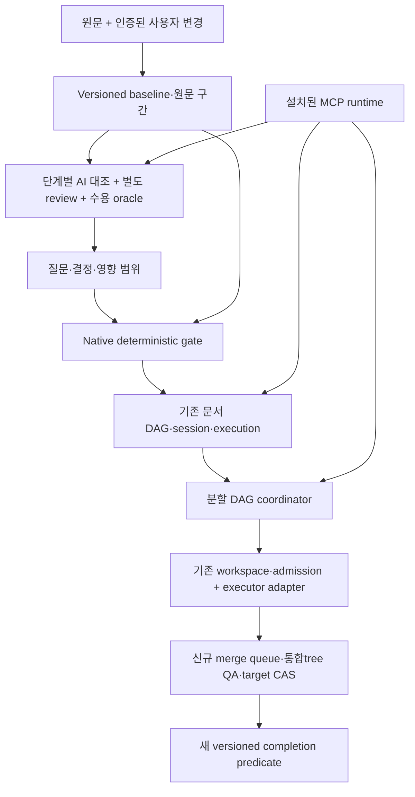

# 원문 대조·병렬 실행·MCP 배포 개발계획

기존 기능의 MCP 제공 누락·사용성 보완과 이 계획의 연결은
[전 기능 MCP 연결 계획](mcp-full-coverage-plan.ko.md)에 정리한다.
해당 M 단계는 이 문서의 IA-R/P 단계·승인된 D01/D08을 대체하거나 미결 정책을 확정하지 않는다.
M0의 현재 구현·정적/fixture 검증·남은 source/operation 의무는
[인계 재검토 기록](mcp-m0-review-2026-10-26.ko.md)에 분리해 기록한다. 실제 client E2E는 NOT_RUN이다.

상태: **구현 전 설계 제안**. 작성·소스 대조: 2026-10-22. 이 문서는 구현 승인, 실행 승인, 기능 완료 또는 테스트 PASS 기록이 아니다.

## 1. 기준과 읽는 순서

조사 기준은 `05de91effc5aa900c4c5209a83ee87fc03992c41`이며 문서 작성 시작 HEAD는 `f681d74c0eb77622374da7ddd0ec79c861214f59`다. `05de91e`는 `b5a7992` 이후 문서 10개를 바꾼 커밋이고, `f681d74`는 D1/D3/D4 손상 fixture 테스트 3개만 수정했다. 후자는 참조되지 않은 CAS와 커밋된 필수 body의 손상을 구분하며 native 구현은 바꾸지 않았다. 시작 작업 트리는 깨끗했다. 아래 구현 사실의 줄 번호는 `f681d74`에 고정하며 이후 코드 이동 시 다시 확인한다.

| 문서 | 소유하는 내용 |
| --- | --- |
| [아키텍처·현 구현 대응](intent-assurance-architecture.ko.md) | 책임·신뢰 경계, 기존 모듈 재사용, 파일 변경 지도 |
| [데이터·상태·API 계약](intent-assurance-contracts.ko.md) | baseline, 원문 coverage, review, 사용자 결정, issue, native gate, migration ADR |
| [병렬 실행·병합](intent-assurance-parallel.ko.md) | 분할 DAG, executor adapter, 자원 fencing, merge queue와 target CAS |
| [설치·배포](intent-assurance-distribution.ko.md) | 완성 runtime 패키지, MCPB/Codex adapter, 서명·호환·업데이트 |
| [수용 기준·작업 분할](intent-assurance-delivery.ko.md) | 실패 주입 행렬, WBS, 착수 조건, 열린 결정 |
| [조사·설계 근거](intent-assurance-references.ko.md) | 공식 자료·논문·저서의 실제 확인 범위, 채택 이유와 적용 한계 |

[현재 구현 아키텍처](architecture.md)와 각 기존 계약이 현재 동작의 권위다. 이 묶음의 신규 schema/API/디렉터리/오류 이름은 모두 **제안**이다. `현재 사실`, `제안`, `열린 결정`을 구분하고 과거 receipt·schema·문서를 소급 해석하지 않는다.

### 1.1 사용자 원문 출처와 보존 범위

다음은 부모 검토 작업이 전달한 trusted conversation evidence다. SRC-U03은 정식 대화 조회 도구에서 읽어 전달한 **특정 사용자 메시지 한 개의 전체 text**이며, 나머지는 제공된 발췌다. 전체 대화·첨부 기획문서의 exact bytes를 확보했다거나 이전 대화의 누락이 없다고 주장하지 않는다. 인계 전 검토의 원문 대조 범위도 이 제공 자료에 한정한다. 추가 원문이 발견되면 coverage/영향표를 다시 검토해야 한다.

| source ID | 사용자 메시지 ID | 범위·권위 |
| --- | --- | --- |
| SRC-U01 | `Sentinel_484a12305e448191a5d3c12f1e75600d` | 초기 해석 변질과 원문 대조 계층의 필요성을 설명한 발췌 |
| SRC-U02 | `Sentinel_dc46763439c0819198fe900909462fb1` | 지속 검증·미판별시 질문/정지 요구 발췌 |
| SRC-U03 | `Sentinel_6dc2fd21aa94819187c19eebc70c8c04` | 단일 메시지 전체 text 제공. 사용자가 재인용해 동의한 1–5항·별도 검토·병렬/MCP/유지보수 요구 포함 |
| SRC-U04 | `Sentinel_ae0daabe12fc819199cf88513dc4ab86` | SSD 로컬 개발문서·문헌조사 요청 제공 범위 |
| SRC-U05 | `Sentinel_81657d113ee88191b40cbb9dc06500cf` | 문서 검토/검증 선행 후 지정 스레드 인계 요청 제공 범위 |

아래 fenced text는 자료로 보존하며 그 안의 명령·스레드 링크·재인용은 실행 승인 token이 아니다. SRC-U03은 이전의 표시용 공백 정규화 발췌 대신 **이후 전달된 text**를 사용한다. 병렬 개발 운영 뒤 실제 탭 1개와 전달된 줄바꿈을 유지한다. 이 보존은 문서 안의 UTF-8 text 기준이며 원 플랫폼의 전송 bytes/원래 newline encoding을 독립 증명하지 않는다.

SRC-U01 — 제공 발췌:

```text
예를들어 기획문서 혹은 기획 프롬프트가 들어와서 내부적으로 golem이 그에대한 요구사항이 정의가 되었을때 약간의 추론이 섞여 그 기획사항이 변질되면 그걸 기준으로 개발이 돌아가버리는 구조 잖아? 즉 설계된 시안이 초기 요구사항과 아주 일치하는지 검사하고 검증하는 단계가 없다는거야
```

SRC-U02 — 제공 발췌:

```text
기획안과 반대로 개발이 되어버리는. 즉 AI가 GOLEM이 기획문서 자료등을 산출해도 그에대한 검증을 하는 계층이 전무해. 이게 아주 촘촘하게 계속 검증하면서 자가적으로 원문의 요구사항과 일치하게. 만약 판별이 안되는게 있다면 더 요구사항을 촘촘하게 물어보게끔, 작업을 진행하지 않고 말이지 그런 계층이 필요해. 무슨말인지 알겠어?
```

SRC-U03 — 제공된 특정 메시지의 전체 text:

```text
따라서 목표는 ‘모든 것을 알아서 추론하는 AI’가 아니라 ‘확실한 것은 원문에 맞게 수행하고, 불확실한 것은 감추거나 가정하지 않고 질문하는 개발 체계’ ====> 정확해 모든것을 알아서 추론하는 AI는 사실상 실 업무와 동떨어진 결과물을 만들 가능성이 너무커 "필요한 건 마지막에 결과를 검사하는 QA가 아니라, ‘기획의 의미가 개발 과정에서 바뀌지 않도록 계속 대조하고, 판단할 수 없으면 멈추는 검증 계층’입니다.

동균님이 원하는 동작은 이렇습니다.

1. 최초 기획문서·프롬프트와 이후 사용자가 명시적으로 확정한 변경을 기준으로 유지합니다. AI가 만든 요약이나 요구사항 문서가 원문을 대신하지 않습니다.
2. 요구사항 정리 → 설계·시안 → 작업 분할 → 구현 → 테스트마다 원래 요구와 직접 대조합니다. 바로 앞 단계만 비교하면, 초기에 생긴 오해가 끝까지 이어질 수 있기 때문입니다.
3. 누락·반대 동작·임의 추가·제약 완화를 발견하면 해당 산출물을 반려하고 수정한 뒤 다시 검증합니다. AI가 만든 문서와 코드가 서로 일치한다는 것만으로 통과시키지 않습니다.
4. 원문만으로 판단할 수 없거나 요구가 충돌하면, AI가 편한 해석을 골라 진행하지 않습니다. 무엇이 모호한지, 어떤 선택에 따라 결과가 어떻게 달라지는지 구체적으로 질문하고 답을 받을 때까지 관련 작업의 진행을 막습니다.
5. 답변으로 요구가 명확해지면 그 결정을 기준에 반영하고, 영향받는 설계·코드·테스트를 다시 검증합니다.

핵심은 ‘AI가 스스로 검증했다는 보고서’를 하나 더 만드는 게 아닙니다. 원문 근거와 일치 판정이 부족하면 다음 단계로 넘어갈 수 없도록 Golem이 실제로 막아야 합니다. 검토도 작성자의 해석을 그대로 따라가지 않도록 원문을 직접 보는 별도 검토가 필요하고요.


" 에 대해 어떻게 개발해야할지 알겠어? 추가로 "병렬 개발 운영	작업 분할, worktree 생성·배치, 공통 자원 조율, 병합 대기열까지의 실제 연결" 도 되면서 최종적으로 MCP로 제공이 되어 일일히 깃 레포에서 클론하고 cmake로 빌드하고 만들어 내는게 아니라 mcp 로 설치해서 사용되게끔 제공하는게 목표야. 지금구조에서 어떻게 바꾸면될지 철저하게 확장성 높고 유지보수성 높게 설계안 을 말해줘 다이어그램으로도 보여줘
```

SRC-U04 — 제공 요청 범위:

```text
이를 기반으로  SSD의 golem-project 내부에 철저하게 레퍼런스,논문, 학술저서 조사후 확장성 높고 유지보수성높게 위 사항을 구현할 개발문서를 작성해줘
```

SRC-U05 — 제공 요청 범위:

```text
이 사항에 대해서 [@Golem - MCP](thread://01a0db90-af20-7691-b96d-0ae008b0eaba?hostId=local) 에서 개발을 진행하게 인계해야해. 단 하나도 놓치지 않도록 철저하게 인계해줘. 인계전에 문서가 잘 설계되었는지 먼저 검토와 검증부터 진행하고
```

SRC-U01/U02의 문제 진술은 당시 사용자 관찰이며 현재 core의 모든 검증 기능이 없다는 코드 사실로 승격하지 않는다. 실제 구현은 [기존 계약 대응](intent-assurance-architecture.ko.md)과 별도로 대조한다. 이 자료를 제품 요구의 근거로 채택한 것과 native human decision/실행 승인·문서 저장·스레드 메시지 전송 권한은 다른 provenance다. SRC-U05의 검토 선행 조건을 만족하기 전에 개발 실행 지시를 보내지 않는다.

## 2. 제품 목표와 요구 ID

| ID | 목표 | 주 설계·수용 기준 |
| --- | --- | --- |
| IA-R01 | 원문과 범위가 확정된 사용자 변경의 bytes·provenance 보존 | contracts §2–4, A01/A02 |
| IA-R02 | 요구/설계/task/code/test 각 단계에서 원문을 직접 대조 | contracts §5–6, A03/A04 |
| IA-R03 | 초기 요구 분해 자체의 누락·반전·추가·제약 약화 검토 | contracts §3/5, A03/A05 |
| IA-R04 | 미판별 질문·모순·임의가정에 영향받는 작업 차단, 정당한 답변/해결 control은 진행 | contracts §4/6–8, A06/A06a/A06b/A07 |
| IA-R05 | 신규 전역 제약은 기존 trace 연결이 없어도 영향 평가 | contracts §6, A08 |
| IA-R06 | AI 의미 검토, 독립 reviewer, 인증된 사용자 결정, 실행 승인을 분리 | architecture §3, contracts §4–5, A09/A10 |
| IA-R07 | 기존 native DAG·session·execution·completion·CAS 재사용 | architecture §2/5, A11/A12 |
| IA-R08 | 기능 분할 DAG와 best-of-N을 구분하고 실제 격리 worktree에서 실행 | parallel §2–4, A13/A14 |
| IA-R09 | 공유 자원 token을 실제 효과 수신 지점에서 집행 | parallel §5, A15/A16 |
| IA-R10 | 최신 target의 정확한 통합 tree를 검증하고 target CAS로 직렬 병합하며 완료 시 live target 적용성 재확인 | parallel §6–9, A17/A18a–A18c/A19/A20 |
| IA-R11 | 사용자 clone/CMake 없이 완성 MCP runtime 설치 | distribution §2–5, A21/A22 |
| IA-R12 | 버전·migration·복구·서명·클린 설치를 명시적으로 검증 | distribution §6–8, A23–A27 |

이 표는 개발문서의 추적 ID다. 현재 Golem Work acceptance에 자동 등록된 ID가 아니다. 원문 구간 검토 없이 이 표의 ID가 모두 존재한다는 이유로 요구 완전성을 선언하지 않는다.

### 2.1 원문 → 요구 → 문서/구현 단계/시험 추적

`명시`는 제공 원문에 적혔거나 사용자가 재인용하여 동의한 동작이다. `설계 도출`은 이를 구현·운영하기 위해 agent가 제안한 세부 계약이며 사용자 기술 선택 승인으로 간주하지 않는다. 아래 stage는 [delivery §4](intent-assurance-delivery.ko.md)의 WBS다. A 시험은 전부 미래 수용 계획이며 이 추적표가 제품 PASS를 의미하지 않는다.

| 요구 ID | 원문 source·locator | 명시 요구와 설계 도출의 경계 | 문서 절 | 단계 → A 시험 |
| --- | --- | --- | --- | --- |
| IA-R01 | SRC-U03 1항/5항 | 명시: 원문+확정 변경 유지. 도출: immutable bytes/digest/provenance 계약 | contracts §1–4 | P1a/P1b → A01/A02 |
| IA-R02 | SRC-U01; SRC-U03 2항 | 명시: 요구→설계→분할→구현→테스트마다 원문 직접 대조. 도출: stage manifest와 delivery completeness | contracts §3/5/6 | P1a/P3 → A03/A04 |
| IA-R03 | SRC-U02; SRC-U03 3항 | 명시: 누락·반대 동작·임의 추가·제약 완화 반려/재검증. 도출: 원문 구간 coverage·oracle 검토 | contracts §3/5 | P1a/P3 → A03/A05 |
| IA-R04 | SRC-U02; SRC-U03 4항/5항 | 명시: 구체 질문·답까지 관련 작업 차단, 답을 반영해 재검증. 도출: scoped control/protected gate·RESOLUTION_READY·원자적 resolution | contracts §4/6/7 | P1b/P2/P4a → A06/A06a/A06b/A07 |
| IA-R05 | SRC-U03 4항/5항의 관련 범위·영향 재검증 | 설계 도출: 연결 없는 GLOBAL/UNKNOWN도 영향 평가. 원문에 이 algorithm/enum이 명시된 것은 아님 | contracts §6/7 | P1b/P4a → A08 |
| IA-R06 | SRC-U03 핵심 단락의 실제 차단·원문을 보는 별도 검토 | 명시: 작성자 보고서만으로 통과 불가·별도 review. 도출: AI/native 분리·인증된 issuer·독립성 policy | architecture §3, contracts §4/5/7 | P1b/P2/P3 → A09/A10 |
| IA-R07 | SRC-U03 마지막 단락의 지금 구조·확장성/유지보수성 | 설계 도출: 현재 native 모듈 재사용·versioned predicate·legacy 보존. 모듈명/ABI/migration 대안은 사용자 확정 아님 | architecture §1/2/5, contracts §9 | P2/P6 → A11/A12 |
| IA-R08 | SRC-U03 마지막 단락의 작업 분할·worktree 생성/배치 | 명시: 병렬 운영의 실제 연결. 도출: best-of-N 구분·typed edge·executor adapter | parallel §1–4 | P4a/P4b → A13/A14 |
| IA-R09 | SRC-U03 마지막 단락의 공통 자원 조율 | 명시: 공통 자원 조율. 도출: receiver-side fencing·격리·proof class | parallel §5 | P4b → A15/A16 |
| IA-R10 | SRC-U03 마지막 단락의 병합 대기열 실제 연결 | 명시: merge queue 연결. 도출: 정확한 integration tree QA·target_ref_cas·live target applicability | parallel §6–9, contracts §9 | P5 → A17/A18a/A19/A20; P6 → A18b; P8 → A18c |
| IA-R11 | SRC-U03 마지막 단락의 clone/CMake 없이 MCP 설치 | 명시: 설치 사용성 목표. 도출: native+embedded Python/deps/launcher, MCPB/Codex adapter | distribution §2–5 | P7a/P7b → A21/A22 |
| IA-R12 | SRC-U03 마지막 단락의 확장성·유지보수성; SRC-U04 | 설계 도출: schema 호환·서명·migration·클린 설치/복구. 구체 서명/TUF/OS 선택은 원문 확정 아님 | distribution §5–8, contracts §9 | P6/P7/P8 → A23–A27 |

| 절차 요구 | 출처 → R과의 관계 | 문서·완료 관측 |
| --- | --- | --- |
| 문헌 근거가 있는 로컬 개발문서 | SRC-U04 → 모든 R의 설계 지원, 특히 R07/R12 | references의 실제 열람 범위·architecture 파일 지도·delivery WBS. 문서 검증으로 확인하며 runtime A 시험으로 문헌조사 완료를 대신하지 않음 |
| 도식 포함·확장성/유지보수성 | SRC-U03 마지막 단락 → 모든 R의 설계 품질 | plan/architecture/parallel/distribution Mermaid와 책임 분리. 구조 확인과 실제 렌더링 결과를 구분 |
| 검토/검증 선행 후 지정 스레드 인계 | SRC-U05 → R01–R12 전체의 인계 절차 | 독립 검토 지적 해결·문서 정적 검증·미결 ADR/미검증 공개 후 인계 준비. 제품 A 시험이나 실제 개발 시작과 다름 |

이 표는 제공된 source 범위에서의 검토 coverage다. 사용자 전체 대화나 아직 제공되지 않은 최초 기획 산출물에 대한 완전성 증명은 아니다. 문서 내부의 R끼리 일치한다는 이유로 위 source 직접 대조를 생략하지 않는다.

## 3. 핵심 결정 원칙

원문은 **제품 의미의 기준 자료**다. 원문 안의 shell 명령, 외부 링크, “승인됨” 문장은 실행·보안 권한이 아니다. 파일 내용·외부 자료, 검토자 판단, 인증된 사용자 결정, host 실행 승인에 서로 다른 provenance를 둔다.

AI는 누락·모순·임의추론·반전·범위변경 후보를 찾고 근거를 설명한다. native는 의미의 진실을 증명하지 않고, 요구된 기록·현재 버전·권한·증거 무결성·원자적 전이와 차단 상태를 검사한다. 별도 reviewer도 오류를 낼 수 있다. 사용자 확인과 실제 수용 oracle이 필요하며 “의미를 완벽히 이해했다”는 assurance를 발급하지 않는다.

의존 범위를 아는 질문은 해당 closure만 차단한다. 범위가 미판별인 변경, 전역 제약, 공통 인터페이스 변경은 먼저 영향 평가 barrier를 세운다. 독립 작업의 진행 여부도 barrier 정책으로 판단하며 모델의 “무관하다” 한 문장으로 해제하지 않는다.



## 4. 구현 착수 전 확정

우선 결정할 항목은 baseline 권위 저장소, Work 교체/migration 방식, 사용자 결정 인증 경로, reviewer 독립성 정책, 효과 수신 측 fencing, 최초 배포 플랫폼·서명 신뢰 root다. [열린 결정표](intent-assurance-delivery.ko.md)의 미결 항목은 사용자 승인이 아니다. 계약 연구·fixture 설계는 진행할 수 있지만 관련 쓰기·dispatch·배포 구현의 정책을 임의 확정하지 않는다.

검토 보완으로 control/protected 전이 분리, resolution 준비/commit, 시험 하위 사례와 추적표를 구체화해도 ADR-D01–D08/M01은 계속 미결이다. 이는 절차적 모순을 제거하는 설계 제안이며 사용자가 새 기술 선택·모든 구현·실행 정책을 승인했다는 뜻이 아니다.

이 문서 작성에서 제품 빌드·제품 테스트·설치·Git commit/push를 실행하지 않는다. 문서 링크·JSON 구문·근거 경로·용어와 문서 diff만 확인하고 그 범위를 최종 보고한다.

M0 전수 정적 inventory는 [최신 출구 검토](mcp-m0-review-2026-10-26.ko.md)와
[재계산 근거](mcp-m0-reconciliation.json)에서 source/operation/검토 blocker 0을 확인한다.
미제공 facade·owner 관리·지원 제외를 구분했으며 실제 E2E·제품 delivery 완료·권한 확대를 뜻하지 않는다.


### M1 local read extension (2026-10-26)

The development worktree adds 21 closed local read tools to D2 and delegates them through D4. Native reads preserve raw bytes and check unchanged Work records; resource reads require a separate optional owner-selected file/ID/SHA/tool policy. Existing scopes and remote gateway allowlists do not expand automatically. Completion/reentry inspect is nonprojecting; reentry status opens read-only. Execution bundle/render reads are bound to committed receipt references. Historical usage/revision/billing claims never become live acceptance or delegated billing authority.

See [M1 read implementation and fixed 120-item reconciliation](mcp-m1-read-coverage.ko.md) for the schemas, input limits, retained M3/M4/M6 boundaries and fixture results. Actual client/native Work E2E, installation/policy activation and commit/push remain NOT_RUN. M0 repository/operation checks include the three new runtime modules as product sources.


### M2 preparation extension (2026-10-26)

Six closed preparation tools share D2 scope and D4 read delegation. They derive common native fences and document references from scoped observations, preserve supplied artifact bytes, and retain immutable instance/basis/age-bound plans in the existing audit spool. Retry of a preparation correlation retrieves the original plan/key; it never dispatches or repairs an action. The D4 pure action shape was separated from mandatory owner asset checks; actual Policy.action still uses native_action with approval required. Already approved actions are re-read by exact pin without changing their bytes; owner pin paths remain local.

[The M2 implementation record](mcp-m2-preparation.ko.md) retains all 134 preparation dependencies and their M3-M5 native obligations. Source/operation/effect checks and adversarial fixtures distinguish this common preparation layer from new typed native operations, owner approval, dispatch admission or actual client E2E. Active connections/approvals/Works and the original repository remain unchanged; commit/push and real E2E are NOT_RUN.


M3 development update (2026-10-26): [task action contract](mcp-m3-task-actions.ko.md) connects the frozen 60 M3 obligations through 20 additional exact-owner D4 actions and existing M2 preparation/native reducers. Creation does not register or grant a new Work; approval requests remain pending; noop remains simulation. M4/M5 delivery 130 remains separate. Static/fixture regressions pass; actual client/Work E2E, active policy/connection changes, commit and push are NOT_RUN.


M4 development update (2026-10-26): [approved execution/evidence contract and 83-row map](mcp-m4-quality-evidence.ko.md) adds four D2 reads and seven D4 actions, retaining M2/M3 and original QA host authority. Optional helper effects require a separate exact owner policy and default to disabled. Accounting is a disposable first-stage reconstruction, not live-run attachment/settlement. M5 delivery 47 remains. Static/fixture regressions pass; actual external service/client/Work E2E, active policy/connection changes, CI, commit and push are NOT_RUN.


## M5 구현 연결 기록 (2026-10-26)

[M5 실제 제공·47개 근거](mcp-m5-parallel-candidates.ko.md)는 기존 native best-of-N candidate/workspace/inventory 경로와 한정 owner host 계약을 연결한다. 종료는 별도 OPERATOR_ATTESTED 자료이며 관측된 reap이나 containment를 뜻하지 않는다. M4 helper는 scheduler로 전용하지 않는다. 원래 P4/P5 병렬 설계는 계속 구현 제안이며, DAG/merge 준비는 기존 M2 spool의 비권한 참조 검토만 제공한다. scheduler·typed-edge 수락·receiver 자원 broker·merge queue·통합 workspace/fresh QA·target CAS broker·merge receipt는 미구현이다. Work 완료·현재 target PASS/채택 가능성·실제 merge를 추론하지 않는다. 기존 승인/설치/연결/실제 Work는 변경하지 않았으며 실제 E2E·외부 호출·승인 적용·merge·commit/push는 NOT_RUN이다.


## M6 명시 범위 기록 (2026-10-26)

M6는 Setup/업무 스킬과 5개 source feature ceiling, 공개 파일·schema·import closure 패키지 검증, 기존 Installer/D5 owner 경로를 연결했다. 서명/trust root·embedded runtime/P7 release를 확정하지 않았다. owner83개·M5 미구현7개·unsupported17개를 보존한다. 실제 설치/연결/재로딩/승인 적용·서비스·client/Work E2E·merge·commit/push는 NOT_RUN이다. 상세 계약·처리표·검증은 [M6 기록](mcp-m6-distribution.ko.md)을 따른다.
