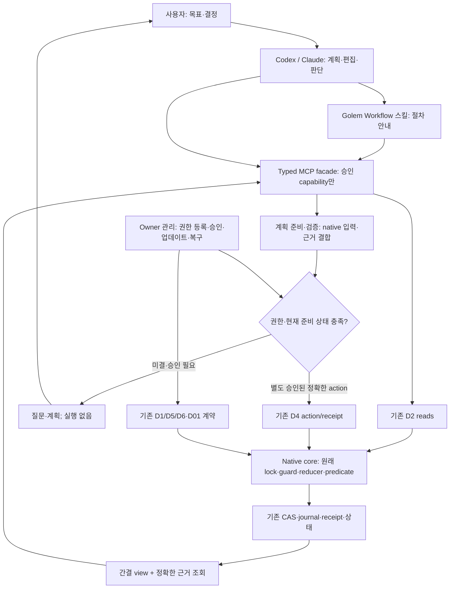
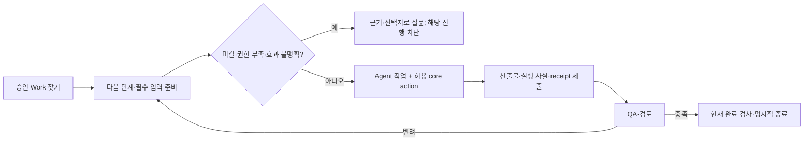

# Golem 전 기능 MCP 연결·사용성 통합 설계와 구현 계획

상태: **M0~M4 및 M5 native facade 47개의 명시 범위 코드/정적/fixture 검증 완료. M6 profile·스킬·검토용 패키징·기존 owner 관리 경로의 코드/정적/fixture 검증 포함. P4/P5 7개 미구현·P7 정식 배포·M7/M8 운영/실제 client 검증은 남음**. 작성·결정 반영일: 2026-10-26.
소스 기준: `2e690091a55f366d5f99580ee375fca7610f2f77`.
새 schema·권한·저장 형식·설치 변경의 승인이나 기능 완료 선언이 아니다.
현재 M7/M8 요청은 별도 테스트 scope의 실제 Codex/Claude 설치·연결·Work E2E와 최소 모델 호출을 승인했다.
생산 연결·승인·기존 증거·TRAP·Work는 보존하며 commit/push·실제 merge·외부 데이터 변경은 금지한다.
상세 관측과 미충족 조건은 [M7/M8 기록](mcp-m7-m8-validation.ko.md)에 구분한다.

## 1. 목표·권위·범위

사용자가 CLI 순서·native JSON·token·digest를 직접 조립하지 않고 Codex·Claude에서
승인된 Golem 기능을 찾아 작업하도록 한다. agent는 의도 해석·계획·편집·검증 판단을,
Golem은 상태·의존성·소유권·최신성·증거·완료 계약 검사를 담당한다.
범용 agent 실행 daemon은 필수가 아니다.

기능 coverage, 사용 편의, 실제 client 검증을 별도로 판정한다. D1~D6의 제한된 구현
완료나 읽기 호출 성공을 전체 목표 완료로 확대하지 않는다. 모든 C 함수를 독립 모델
도구로 만드는 목표도 아니다. 사용자 기능마다 실제 MCP 또는 명시적인 owner 관리
경로가 있어야 한다. 그 권한 경계는 §10의 채택된 COV-D01을 따른다.

| 문서 | 유지할 권위 |
| --- | --- |
| [현재 아키텍처](architecture.md), [역할 경계](agent-golem-boundary.md) | 원래 core·lock·reducer·완료 predicate |
| [D1~D6 설계](integration-layer-design.md)와 단계별 계약 | registry·전달·typed action·유지보수·gateway |
| [원문·병렬·배포 계획](intent-assurance-plan.ko.md) | IA-R 요구와 P 단계. 의미 검증·scheduler·merge queue·완성 runtime을 중복 설계하지 않음 |
| [D01 host](intent-assurance-d01-host.ko.md), [P1a store](intent-assurance-p1-object-store.ko.md) | 승인된 D01/D08·proposal 저장/reader·기존 복구 경계 |
| [소스 목록](mcp-capability-inventory.ko.md) | 48 header·344개 header별 이름·31 CLI route·74 Python 모듈의 정적 입력. operation coverage 인증은 아님 |

첨부 두 하네스 비교는 역할·작업판·검증·병렬·승인 마찰의 요구 분석 자료다.
그 안의 명령·자동 승인·수치·문헌 주장을 실행 권한이나 Golem 보장으로 가져오지 않는다.
사적 프로젝트 경로·첨부 원문 전체는 공개 저장소에 복사하지 않는다.

## 2. 현재 구현·MCP 공백 지도

`integration_service.SCHEMAS`에는 M1/M2/M4/M5 포함 D2 도구 43개, `integration_mutation_contract.NAMES`에는
M3/M4/M5 포함 D4 도구 37개가 있다. 최초 D2/D4의 각 7개에서 확장된 개발 상태다. 설치 정책이 모두 허용한다는 뜻은 아니다. 기존 합성 연결의
3 Work·읽기 6도구 승인은 확대하지 않는다. 다음 표의 기능군 안 operation까지 M0에서 분해한다.

| 기능군 | 기존 구현 재사용 | 현재 경로·남은 연결 |
| --- | --- | --- |
| 설치·연결·진단 | installer, MCPB/Codex 생성기·launcher·doctor | setup 존재. 전체 profile·완성 runtime 배포는 별도 |
| 프로젝트 승인·해제 | D1 registry/config/install, D5 | owner 경로. 모델이 grant/pin을 재승인하지 않음 |
| Work 생성·등록·열람 | document store/work start, binding, bootstrap | 조회 존재. bootstrap과 일상 creation/등록을 구분한 typed 경로 필요 |
| 단계·역할·template·의존성 | workflow/role/template | 선택·enroll·평가·필수 입력 설명 연결. 독립 reviewer 인증은 현재 보장이 아님 |
| 세션 수명주기 | agent_session/session_binding/lease | D4 claim/begin/resume/reconcile/submit 존재. heartbeat/release/reject 등 실제 operation 전수 분류 |
| 문서 작성·개정·제출 | registry·parent closure | D4 submit 존재. 준비·검증·parent 수집·receipt 연결 사용성 개선 |
| 맥락·이력·인계 | context/workflow/history, D2 | 읽기 존재. 인계 준비와 ownership 이전·모델 소비·실행 허가 구분 |
| 개발·QA·자원·profile | execution/approval/runtime_profile/resource | D4 exact action 존재. prepare/finish/QA 계획 준비와 owner 승인 분리 |
| 완료·반려·재진입 | completion/reentry/report | completion_check 존재. finalize/report·현재 revision 기반 재진입 연결 필요 |
| 증거·proof·lineage·export | evidence/proof/lineage, evidence contract/export | 제한 evidence_read 존재. export·검증 수준·허용 참조 범위를 각각 연결 |
| 연구·판단 변경분·outcome | research, judgment_record | CLI/Python 재사용. 일반 작업에 연구 schema를 강제하지 않는 선택 기능 |
| 사용량·비용·청구 | cost, provider_usage/costs, hosted_usage, usage_pipeline, billing_evidence | 수집/귀속 기반 재사용. 조회·수집·대사·credential 관리 권한 분리 |
| revision·CI·배포 | revision_status/status_collector/github_* | 수동 조회·반복 service·원격 변경 구분 |
| workspace·candidate·inventory | workspace/candidate/inventory, trusted host | native 격리 기반 존재. 배치·검증 workspace·자원 운영의 MCP 연결 부족 |
| runtime·worker·admission·daemon | runtime/prepared_runtime/worker/admission/daemon | host API 존재. noop을 실제 agent 수행으로 설명하지 않음. 직접 실행은 opt-in |
| event·기록·오류·replay | event_reader/runtime_event/record/system_error/journal/replay | 관측/검증 우선. salvage·복구는 owner 전용으로 제안 |
| cache·optimization·policy·protocol | budget/optimization/policy/adapter/codec | 사용자 기능은 typed 진단·설정; 메모리/codec 함수는 adapter 내부 분류 |
| 원문·baseline·intent | D01/D08/P1a validator/store/reader | proposal 저장/조회와 미구현 adoption/ACTIVE/의미 인증 구분. D1 registry와 권한 혼합 금지 |
| 원격·업데이트·복구 | D5/D6, D01 terminal/final | gateway 인증은 native owner 승인 아님. 최종 승인 이후 추가 복구 계층 금지 |
| 도메인 골든셋·회고 | 프로젝트 QA 명령·artifact·adapter | 증거/권한 연결. 프로젝트별 기준을 core에 하드코딩하지 않음 |
| 병렬 분할·scheduler·merge queue | 기존 [병렬 설계](intent-assurance-parallel.ko.md) P4/P5 등 | 기반과 신규 개발 구분. 문서의 조립 라인이 이미 MCP에 있다고 하지 않음 |

`session call` 진입점 하나를 모든 session operation의 제공으로 세지 않는다.
proposal과 미구현 기능은 기존 기능 연결 coverage와 별도 표시한다.

## 3. 통합 아키텍처

SDK transport/domain service/native adapter/owner approval adapter/client package를 분리한다.
native reducer·QA parser·lock·완료 predicate를 Python/스킬에 재구현하지 않는다.
CLI가 있는 기능은 고정 요청으로 재사용하고 host callback은 제한된 trusted host에서
제공한다. 임의 shell·argv·path·환경을 받는 범용 dispatcher는 만들지 않는다.

기존 D4는 exact bytes/action pin을 요구한다. adapter가 token/sequence/input을 준비해도
**승인 전 계획**이다. 기존 승인 action의 bytes를 바꾸지 않는다. 새 typed action은
별도 schema·권한·시험 후 추가한다.

## 4. Capability ledger·누락 검사

M0에서 아래 필드의 ledger와 생성 검사를 구현한다. 정확한 schema/저장 형식은 미확정이다.

| 항목 | 용도 |
| --- | --- |
| ID/version/native entry/operation/schema | 함수·CLI·JSON operation과 사용자 기능 연결 |
| 구현 상태 | IMPLEMENTED/PARTIAL/PROPOSED/UNSUPPORTED와 근거 |
| 제공 경로 | MCP_READ/MCP_REVIEWED_ACTION/OWNER_ONLY/HOST_INTERNAL/PROPOSED_NOT_IMPLEMENTED |
| 효과 | native read/write·audit write·disclosure·child process·network/Git·cleanup 각각 표시 |
| 권한·guard | D1/D2/D4/native approval/host guard 교집합, owner/binding/token/input/sequence/source/revision·lease·보호·quota |
| 한도·platform | native/출력 한도, 지원과 실제 검증 OS/client |
| 경로·검증 | tool/operator/adapter 또는 제외 근거, tests/docs/package profile |

ledger는 권한 DB가 아니다. 도구 발견·설명·Work 문서에서 권한을 만들지 않는다.
공개 기능 설명과 승인 project/Work capability를 분리하고 미승인 이름·경로를 누출하지
않는다. tools/list는 승인 교집합만 제공한다. 전역 활성 Work를 암묵 선택하지 않는다.

새 API/CLI/schema operation은 ledger diff를 CI에서 요구한다. UNCLASSIFIED가 남으면
coverage gate 실패다. OWNER_ONLY/HOST_INTERNAL도 근거와 실제 경로가 필요하다.
제외 항목이나 proposal을 완료율에 합쳐 누락을 숨기지 않는다.

## 5. 간편한 작업 흐름

1. 승인 Work·허용 행동·blocker를 읽는다. 숨겨진 filesystem 탐색은 없다.
2. agent가 목표·범위·산출물을 제안하고 기존 template/schema로 검사한다. creation/등록
   권한이 없으면 owner에게 정확한 범위를 제시하고 실행하지 않는다.
3. status/next/current inputs에서 계획을 준비한다. agent는 판단·산출물을 작성하고
   adapter는 revision/parent/digest/sequence를 원래 계약에서 수집한다.
4. 승인된 action이나 별도로 검토한 정확한 계획만 실행한다. source drift·owner 충돌이면
   새 계획이 필요하다. 사전 조회를 상태 예약으로 취급하지 않는다.
5. 원본 bytes·정확한 parent/source로 등록·submit하고 원래 receipt를 반환한다.
   등록 성공을 QA PASS나 완료로 승격하지 않는다.
6. 검증 agent가 정확한 입력·소스·결과를 읽는다. FAIL/ERROR는 영향 단계와 질문으로
   연결한다. 독립 검토 주체의 인증 여부는 별도 표시한다.
7. 현재 native completion check 이후 별도 허용된 finalize/report를 수행한다.
   CI·배포·native completion의 revision과 권위를 각각 유지한다.

Golem Setup은 연결 전용으로 유지한다. 별도 Workflow 스킬은 문서/코드/검증/연구의
허용 절차를 안내한다. 기계적 절차를 긴 스킬에 중복 작성하지 않고 일반 작업에 연구
schema를 강제하지 않는다. 미지원 도구를 있다고 안내하지 않는다.
권장안·이유·blocker·다음 도구·승인할 정확한 범위를 함께 보여준다. 대화상 “네”를
지원 승인 채널/binding 없이 native 승인 token으로 바꾸지 않는다. client의 확인을
우회하지 않으며, 같은 범위의 유효한 승인을 매번 다시 요구하지 않는다.

간결 view는 native payload/digest/receipt와 분리된 파생 출력이다. observed heads,
counter domains, required inputs, blockers, next permitted operation, effect/approval
state와 evidence refs를 제공한다. 필드/한도는 제안이다. 요약은 원문·필수 전체 입력·
독립 검토의 대체물이 아니다. 한도 초과는 거부하거나 별도 승인된 분할 계약을 사용한다.
필수 근거를 자동 절단하지 않는다.

## 6. 권한·동시성·불확실성

- D1 read/D2 disclosure/D4 action/QA owner decision/D01 등록은 서로 대체하지 않는다.
  기존 Work 읽기에서 신규 creation 권한을 유도하지 않는다.
- 계획은 정확한 native bytes·현재 heads·owner/binding·source/input·producer와 결합한다.
  apply에서 core가 lock 아래 재검사한다. stale plan은 수정하지 않고 새 계획으로 간다.
- token/request ID를 임의 선택하지 않는다. 결과 재조회와 새 실행을 구분하며 receipt가
  있어도 현재 권한/freshness를 검사한다.
- timeout·연결 종료·기록 실패로 효과가 미확정이면 COMMIT_UNKNOWN이다. idempotency가
  있어도 자동 재실행하지 않는다. 승인된 기존 복구만 사용한다.
- 다른 살아 있는 owner·RUNNING 중단·boot/clock 변경·보호 drift·pending·손상·quota
  부족은 정확한 이유와 읽기/owner 경로를 반환한다.
- QA writer lock·보호 검사를 유지한다. 동일 UID 외부 shell까지 막는 OS sandbox나
  provider 내부 모든 호출의 관측을 주장하지 않는다.
- compound read는 기존 audit headroom부터 확인하고 매 native read quota도 유지한다.
  무삭제·명시 승인·원위치 manifest 논리 회전 원칙을 보존한다. 미승인인 활성 quota
  제외 조건·전체 보존 한도는 여기서 정하지 않는다. 새 registry로 포화를 우회하지 않는다.
- D01/D08 single authority·최초 lane/peak·terminal/final 경계를 유지한다. 최종 승인
  자체의 부분 게시를 위해 추가 복구 계층을 만들지 않는다. 기존 CAS/journal/receipt/
  등록 revision 수정이나 과거 Work 자동 migration은 없다.

## 7. 배포·업데이트·원격

제안 profile은 diagnostic/read, task-actions, approved-QA, optional research/observability,
host-runtime이다. profile이 권한을 주지는 않는다. 승인된 read/action facade를 한
package에서 선택하도록 설계하되 기존 read-only 연결은 기본 그대로 둔다. 정확한
설정 형식은 아직 승인하지 않았다.

완성 runtime/의존성 배포는 기존 [distribution 설계](intent-assurance-distribution.ko.md)의
P7과 client/OS/signature/호환성 결정을 재사용한다. GitHub catalog와 공식 marketplace
등재를 구분한다. 연결 전환은 D5 계획→owner 검토→quiescence→pin 변경→지원 reload→
실제 노출/호출 확인 순서다. 설치는 정책 자동 재승인이 아니다. 불확실 효과/호환 충돌에
자동 downgrade/rollback하지 않는다. 임시 연결도 별도 승인·예산·정리 범위를 가진다.

원격은 D6 인증/delegate/disclosure/mutation 교집합이다. local 도구 추가로 remote
allowlist를 확대하지 않는다. 현재 제안은 owner 관리를 원격 모델에 열지 않는다.
실제 Hosted OAuth/client 검증을 local stdio/loopback TLS 성공으로 대체하지 않는다.

## 8. 단계별 구현 계획

M은 이번 연결 작업의 분할이며 기존 P·D01/D08을 재번호화하지 않는다. 미결과 독립적인
조사·fixture·읽기는 진행하되, 정책 의존 구현 전에 필요한 결정만 순서대로 묻는다.

| 단계 | 구현 범위·재사용 | 선행 결정/의존 | 출구 조건 |
| --- | --- | --- | --- |
| M0 | operation별 ledger·설치 capability 대조·누락 검사 | COV-D01 경계, ledger 형식 | 미분류 0·제외 근거·새 기능 누락 fixture·제안/구현 분리 |
| M1 | D2 재사용, 누락 workflow/template/role/current inputs/report/usage/revision 읽기 | scope·출력/전달 한도 | native bytes/권위 보존·headroom·stale/손상/거부·읽기 무변경·실제 노출 |
| M2 | 기존 schema 기반 입력 준비·현재 basis·blocker/질문·exact action 확인 | 계획 저장·수명·한도·승인 전달 | prepare native 무변경·위조/타 Work/사후 변경 차단·수작업 입력 측정 |
| M3 | creation/등록·workflow/role·누락 session·문서 준비/제출·reentry·finalize/report | creation·operation별 mutation, D4 exact action 유지 | owner/lease/boot/clock/sequence/token/input/source/binding/보호 회귀·합성 한 사이클 |
| M4 | prepare/finish·QA·proof/export·usage·remote status·research·host adapter | QA effects·provider credential/전달·network/export | 실행/진술 구분·비용 null·결과 유실 격리·hash/진실성 분리·service opt-in |
| M5 | workspace/candidate/inventory와 intent P4/P5 DAG·자원·merge 연결 | 기존 병렬 ADR·target CAS·자원 승인 | Work 격리·owner/자원 경쟁·검증/통합 tree/source/target drift·무승인 merge 차단 |
| M6 | Setup/업무 스킬 분리·기능 profile·설치/reload·distribution P7 | client/OS/runtime/signature/호환성 | 깨끗한 설치·clone/build 없는 목표 실제 검사·기존 연결 보존·설명 일치 |
| M7 | 두 client 동일 합성 흐름·local/remote·새/기존 대화 차이 | 합성 쓰기/실행/전달/호출·비용 승인 | 실제 trace·상태 해석·감사 비용·실패 중단/재기동·Hosted 미검증 분리 |
| M8 | ledger/package/tool/schema/docs/tests 일치·공개 변경 검토·commit/CI | 미결 해소 또는 정식 지원 제외 근거 | 기존 기능 경로 누락 0·잘못된 완료 승격 0·관련 OS CI·비공개 제외 |

M5 신규 scheduler/merge와 intent 의미 검증은 기존 P 단계의 승인을 건너뛰지 않는다.
P1a 저장/coverage 검증은 의미 검토·사용자 채택·ACTIVE 실행 허가가 아니다.
M6 스킬 초안은 M2부터 병행할 수 있지만 미지원 도구 사용을 안내하지 않는다.

## 9. 검증·사용성·최종 완료 기준

### 실행 범위: M7/M8 격리 실검증 승인 (2026-10-26 후속 사용자 결정)

후속 요청이 테스트 전용 설치·client 대화·정확한 owner action·로컬 QA를 승인했다.
기존 생산 연결·승인·증거·TRAP·Work는 유지한다. 실제 관측만 client E2E 근거로
집계하고 fixture/SDK/CLI 성공을 desktop 성공으로 승격하지 않는다.
M8은 고정 source/artifact/설치 bytes와 원장·회귀를 대조하며 다른 OS·원격 CI와
미구현 의무를 실제 상태대로 남긴다. 아래 원래 출구 조건은
장기 검증 목표로 유지하며 개발 완료와 실행 검증 완료를 따로 기록한다.

| 검증 층 | 필수 시나리오 |
| --- | --- |
| 계약 | operation별 schema·권한·효과·한도·version, 부분 성공의 전체 성공 승격 금지 |
| Core | 직접 native와 adapter 비교·lock/fence/reducer·원본/receipt/보호 불변 |
| 경쟁/중단 | 조회 후 변경·동시 owner·timeout·자식 효과 미확정·commit 전후 오류·격리 후 재실행 금지 |
| 보안/전달 | 타 project/Work·임의 path/argv·위조 issuer·문서 명령/승인 주입 거부·목적지 교집합 |
| 보존/용량 | fixture inventory 전후·원래 승인 불변·audit write 구분·quota/불완전 스캔 중단 |
| 일상 종단 | 시작→설계→개발→QA FAIL→수정→QA PASS→현재 완료, 인계·거부·효과 미확정 |
| Client | capacity 먼저·정확한 package/policy·노출/호출 구분·새 대화 필요 여부 |
| 병렬/머지 | 별도 승인 fixture의 자원·worktree·검증/통합 tree·target drift·중단 |
| 배포 | clone/build 없이 설치 가능한지·runtime/의존성·지원 OS·복구 한계 |

같은 과업/안전 조건에서 수동 native JSON 필드, 명령 복사/설정 전환, 필수/중복 승인,
누락 입력·동일 오류 반복, 왕복·출력 bytes·응답 시간·provider 사용량을 측정한다.
필수 검토 제거로 얻은 절감은 성공이 아니다. 미계측 비용은 null/미측정이다. 반복 수·
허용 오차·성공 기준은 합성 실험 승인 전에 결정한다.

전 기능 완료는 ledger 전수 분류·사용자 기능의 실제 경로·owner-only 경로의 사용 가능성·
새 일상 흐름의 두 client 검증이 모두 충족된 뒤 선언한다. 설계·fixture PASS·목록 존재만으로
완료하지 않는다. 문서에 제안된 새 병렬/원문 의미 기능은 구현 전까지 별도 미완료다.

## 10. 필요한 정책 결정 순서

COV-D는 기존 D01/D08과 구분되는 결정 ID다. COV-D01과 COV-D02의 목록 구조 원칙·
닫힌 필드·타입/참조·분류·metadata·decoder/ID·선택 소스 읽기 경계·한정 정적 profile까지 사용자가 채택했다. 미결 제안을 승인으로 적용하거나 기존 승인 사항을 다시 묻지 않는다.

### COV-D01 — 채택된 책임·권한 경계

2026-10-26 사용자가 제시된 선택지 **“일상 작업 MCP + owner 관리 분리 채택”**을 선택했다.

- 일상 Work 생성·진행·제출·검증·종료는 승인된 typed MCP로 제공하는 방향을 채택한다.
- 프로젝트 권한 등록/변경, 승인 발급, runtime 업데이트, 복구·민감한 정리는 별도
  owner 관리 경로에 둔다. 모델에는 해당 관리 작업의 진단·검토 계획만 제공한다.
- 기존 D4 승인 action과 core 권한 검사는 유지한다. 새 도구의 정확한 schema·creation
  scope·승인 전달 방식·배포 전환 등 나머지 정책은 승인한 것이 아니다.
- 이 기록은 대화에서 채택한 설계 결정이다. native 승인 receipt·issuer 인증·project
  grant가 아니며, 기존 연결·합성 범위·쓰기/실행 권한을 확대하거나 활성화하지 않는다.

| 순서 | 결정 | 채택 내용 / 미결 제안 |
| --- | --- | --- |
| COV-D01 — 채택 | agent MCP와 owner 관리 경계 | 위 책임·권한 경계 채택. 새 쓰기/실행 활성화나 정책 자동 확대 없음 |
| COV-D02 — 구조/타입·참조/분류·metadata/decoder·ID/읽기 경계·정적 profile 채택 | ledger·간결 결과·출력/분할 한도 | 닫힌 버전 JSON·관측/분류 분리·Markdown 생성·기본 필드/참조 채택. 미분류/미확인 gate 실패·비권한 목록. 근거 충분성·최종 gate·공개 읽기 결과는 미결 |
| COV-D03 — M2 | 계획 저장·수명·승인 전달·결과 재조회 | exact bytes/current basis. 모델 boolean으로 owner 승인 대체 금지 |
| COV-D04 — M3 | creation·단계/role·session/finalize별 권한 | read와 분리된 scope. 승인 Work 자동 확대 없음 |
| COV-D05 — M4 | QA·provider/network·export 효과/예산 | 기능별 검토. 기존 합성 읽기를 쓰기/실행으로 전용하지 않음 |
| 기존 병렬/배포 ADR — M5/M6 | scheduler·merge·runtime·OS·서명 | intent 미결 순서 재사용, 중복 정책 없음 |
| COV-D06 — M7 | 합성 쓰기/실행·전달·호출/비용·정리 | 실제 Work 제외 fixture를 먼저 제시, 기존 활성 연결 유지 |

COV-D01에 따라 M0 ledger·fixture가 우선이다. 사용자는 2026-10-26 COV-D02의 구조·
필드·타입/참조·분류·metadata·JSON decoder/한도·관측 ID·선택 읽기 경계를 순서대로 채택했다. 다음 미결은
근거 충분성과 최종 gate이며 읽기 결과까지 한꺼번에 동결하지 않는다. [M0 구현·조사·추출 범위 제안](mcp-m0-ledger.ko.md)을 따른다.
필요한 결정을 해당 구현 전에 하나씩 제시한다.

## 11. 이번 작성 범위와 다음 한 단계

최신 추가: 선택 scope의 ledger/관측 대조·Markdown renderer·read-only report CLI,
source/operation 누락 및 drift 검사, MCP 미제공 backlog 분리, 명명된
GOLEM_RECORDED_API wrapper의 정의/호출 hash 고정 추출을 구현했다.
명시 7개 공개 source의 66개 구문 관측은 [JSON](mcp-m0-observations.json)과
[생성 표](mcp-m0-observations.md)에 있다. 전수 registry가 아니며 미해석 9건과
미분류 항목이 남아 있으므로 M0 전체 완료가 아니다. 전체 capability 회귀는
macOS 호스트 149/149 PASS이며 실제 E2E는 실행하지 않았다.

최초 변경은 설계·정적 진입점 목록·기존 문서 링크였다. 이후 사용자의 M0 구현 요청으로
추출 helper·구조/ID validator·bounded decoder·선택 source reader와 한정 정적 profile driver·명시 선택 근거 파일 관측·Python selector 선언 확인·명시적 Markdown 앵커 확인·회귀 125개를 추가했다. 전체 schema·전수 분류·최종 gate는
미완료다. core·package·설정·승인·Work·TRAP·기존 증거는 변경하지 않는다.
명시 선택 test/doc 파일의 bytes/hash 확인을 구현했다. Python selector의 직접 선언 확인도 구현했다. 명시적 Markdown 앵커 확인도 구현했다. 기존 실행 기록의 명시적 연결 원칙을 채택했다. 기존 execution·agent_io·private 기록을 각각 구분해 지원하는 방향도 채택했다. 다음은 입력 경계·한도 결정이며 실제 실행·근거 충분성·최종 gate는 미결이다. 신규 설치·합성 쓰기 검증·활성 연결 전환은 포함하지 않는다.

### 최신 M0 개발 상태 — 2026-10-26

실제 E2E 보류를 유지한다. bytes 기반 execution/agent/private adapter 및 execution의 native
하위 기록 무결성 검사를 추가했다. 추적 경로 897개 추가/삭제 감시, 현재 66개 관측 중
30개 capability 분류와 32개 미분류를 공개한 생성 표를 제공한다. 전수 기능 분류·호출관계/
미해석 scope 해소와 agent native child 연결은 여전히 남아 있다. capability 162개 + D2/D4
fixture 34개가 호스트 통과했지만 이를 M0 완료 또는 제품 PASS로 사용하지 않는다.

### M0 정적 분류 진행 현황 (2026-10-26 후속)

[개발 기록 §6.12](mcp-m0-ledger.ko.md)와 [생성 관측 표](mcp-m0-observations.md)에
CLI root/template 미분류 32개와 추가 하위 분기 92개의 분류를 반영했다. 현재 선택 범위는
158개 관측·154개 capability이며 분류 누락은 0개다. 근거 파일 10개는 operation 추출과
분리했지만, 하위 CLI scope 확장 후 transitive/dynamic/미등록 scope 34개가 남는다.
따라서 M0 출구 통과나 기존 Golem 기능 전체의 MCP 제공 완료를 선언하지 않는다.
회귀 175개 통과는 정적/fixture 결과이며 M0~M8 실제 E2E 보류 정책을 유지한다.

### M0 연결 검사 기본 통합 후속

선택된 D2/D4 선언과 CLI dispatcher에 대한 정적 연결 profile 27개를 M0 기본 누락 검사에
통합했다. 선언 연결 의무 2개만 해소했으며, source 범위 확대를 포함한 전체 차단 항목은
36개(C residual 28·미등록 source 8)다. 관측 미분류 0과 전체 M0 완료는 구분한다.
[최신 개발 기록 §6.16](mcp-m0-ledger.ko.md)에 계약·fixture·미검증 범위를 기록했다.

### M0 native 경계 후속

승인된 공개 native API/capability 종료 경계와 내부 helper 검사로 events scope 1개를
해소했다. 현재 residual은 C 27개·미등록 source 8개(총 35개)이며 전수 완료는 아니다.
required/release named wrapper profile도 추가했다. 상세 계약과 회귀 213개 결과는
[개발 기록 §6.17](mcp-m0-ledger.ko.md)에 기록했다. 실제 E2E 보류는 유지한다.

### M0 인계 재검증 후속 — 이전 기록

[개발 기록 §6.18](mcp-m0-ledger.ko.md)과
[결함·조사·설계 대응](mcp-m0-review-2026-10-26.ko.md)이 현재 상태다.
선택 관측은 164개·capability 160개다. 8개 source의 interface 역할과 필수 연결 검사를
완성했으나, C scope 27개와 하위 효과 미확인 CLI 119개가 선택 gate에 남는다.
completion/reentry report의 투영 쓰기를 읽기 경로로 분류했던 오류도 수정했다.

새 저장소 gate는 index 897개 경로와 미추적 경로를 별도로 대조한다. 명시 선택한
후보 source 424개를 읽고 public 48 header/344 선언과 각각의 직접 정의를 확인했다.
이 구조적 연결을 기능 PASS로 세지 않는다. 공개 API 340개의 capability 연결,
후보 파일 368개의 operation 검토와 다른 경로의 제외 경계 검토 등이 남는다.
정확한 의무는 [재계산 JSON](mcp-m0-reconciliation.json)을 따른다.

| 단계 | 확장 코드 상태 | 검증 상태 |
| --- | --- | --- |
| M0 | 분석기·검토 registry·선택/저장소 gate·fixture 개선 진행, 전체 목록 미완료 | macOS host capability 268/268, D1 25/25·D2 15/15·D4 19/19; 실제 E2E NOT_RUN |
| M1–M6 | M0 이후 확장 미진행. 기존 D1–D6 구현을 해당 M 단계 완료로 확대하지 않음 | 새 확장 수락 검증 미진행 |
| M7 | 새 client harness 확장 미진행 | 실제 client·실제 Work NOT_RUN |
| M8 | 최종 coverage/공개 변경·CI 점검 미완료 | CI·Linux/Windows NOT_RUN, commit/push 미수행 |

M0 출구 조건은 미충족이다. E2E 보류를 이유로 정적 개발을 면제하지 않으며, 위 미완료를
승인 대기라고 바꾸거나 다음 단계의 완료로 계산하지 않는다.

### M0 전수 정적 출구 — 최신 상태

513개 source/근거/계약, 관측 2,107개·capability 1,078개를 고정 tracked 897개와 대조했다.
424개 생산/계약 파일의 전체 표면과 473개 제외 경계를 검토하고, 공개 API 344개·callback
선언 30개·중첩 CLI/Python/FFI operation을 원장에 연결했다. C scope 27개·미확인 효과
119개는 실제 정의/호출/인자/schema/효과 검토로 해소하여 selected/repository blocker는 0이다.

[최신 검토 기록](mcp-m0-review-2026-10-26.ko.md)에 출구 근거·분석 한계·검증을 명시한다.
MCP 미제공 facade 312개는 M1 120/M3 57/M4 88/M5 47로 분리했고 action은 M2 준비에 의존한다.
owner/배포 검토 83개는 M6 경계이며 역사적 지원 제외 17개는 delivery backlog가 아니다.
M0 목록 완전성을 제품 전체 제공 완료나 실행 권한으로 확대하지 않는다. M1–M8 기능 확장은
이번 요청에서 미착수이며 실제 E2E·CI·Linux/Windows는 NOT_RUN, commit/push는 미수행이다.

## M1 구현 이후 최신 상태 — 2026-10-26

M1의 local typed 읽기 21개를 기존 D2 7개와 연결했다. 원래 M1 backlog 120개 ID를 유지하고 기능별 core/argv·resource·fixture 근거를 대조했다. 전체 표와 권한 경계는 [M1 읽기 검토](mcp-m1-read-coverage.ko.md), 실제 재계산은 [원장 대조](mcp-m0-reconciliation.json)의 `m1_read_coverage`를 따른다. 읽기 84·공통 core 7·내부 의존 20·owner 5·혼합 3·source 준비 1을 각각 구분한다. source capture M3, billing 독립 reconciliation M4, owner policy/config 계획·검사 M6 경계를 숨기지 않는다.

전체 source horizon은 기존 424에 새 runtime 읽기 모듈 3개를 추가한 427이다. 명시 source/근거 520개, 관측 2,156개, capability 1,106개로 확장했다. tracked index 기준 897개와 기존 boundary 검토는 유지한다. 새 runtime을 개발 분석 파일로 제외하지 않는다. 분석기/검토 모델/원장은 검사기가 자동 갱신하지 않는다. source·operation·효과·connection·전수 gate의 검토 모델을 명시적으로 갱신했다.

| 단계 | 이번 개발 상태 | 남은 검증·기능 |
| --- | --- | --- |
| M0 | 확장된 horizon의 목록·정적 gate 유지 | 실제 실행/권한 충족을 인증하지 않음 |
| M1 | 읽기 코드·정적 연결·임시 fixture 구현, 선택적 owner resource 계약 | 실제 설치·노출/client E2E NOT_RUN; owner/source/billing 경계는 표의 후속 단계 |
| M2 | 신규 준비 기능 확장 미착수 | 기존 typed action의 준비 의존 유지 |
| M3 | 본격 수명주기 확장 미착수 | context publish·fresh discovery source capture 포함 |
| M4 | 실행/QA 확장 미착수 | billing 검증/정확 join과 evidence 실행 권위 유지 |
| M5 | 병렬/병합 확장 미착수 | 기존 backlog 유지 |
| M6 | skill/패키징 확장 미착수 | 실제 owner 정책·설치·승인·설정 작업 유지 |
| M7 | 실제 client harness 확장 미착수 | Codex/Claude E2E NOT_RUN |
| M8 | 최종 전체 제공/CI 미완료 | Linux/Windows·CI NOT_RUN, commit/push 없음 |

과거의 M0 미완료/M1 미착수 절은 이전 checkpoint다. M1 코드 검증을 계획의 장기 출구 조건인 실제 client 노출 검증으로 바꾸지 않는다. 원본·활성 연결·기존 승인/pin/Work/evidence는 변경하지 않았다.

## M2 입력·준비 이후 최신 상태 — 2026-10-26

M2의 입력/초안/구조 검증/불변 plan/owner action 검토/확인 도구 6개를 기존 D2·D4에 연결했다. [구현·수명·검증 기록](mcp-m2-preparation.ko.md)과 원장 대조 JSON의 `m2_preparation_dependencies`를 따른다. 기존 준비 의존 134개 ID를 보존한다: D4 typed 초안/owner byte 검토 26, core artifact 구조 검증 22, 현재 입력 basis와 후속 native route 경계 86이다. 뒤의 86개를 operation-specific typed schema/실행 제공 완료로 계산하지 않는다. M3 60/M4 45/M5 29의 준비 의존이며 해당 단계의 native 권한·효과·실행 경로는 여전히 별개다.

COV-D03의 구현은 기존 private audit에 저장하는 동일 instance·30분·현재 등록 Work basis의 비권한 plan이다. 사용자 상관 ID는 재조회용이고 native key/D4 request ID를 대체하지 않는다. 같은 요청의 결과 유실 후 재조회는 원래 plan/key/bytes를 반환하며 stale/conflict/재시작 시 자동 복구하지 않는다. owner action 파일·승인·정책을 새로 작성/적용하거나 기존 승인 bytes를 고치지 않는다. 실제 dispatch는 기존 D4/core 검사를 유지한다.

전수 source/근거 525개·관측 2,171개·capability 1,115개, product source 429개로 horizon을 확장했다. source·operation·효과·기존 D2/D4/M1 및 새 M2 profile을 함께 검사한다. 기존 미제공 delivery 190개(M3 60/M4 83/M5 47), owner 관리 83개·역사적 지원 제외 17개는 보존한다. 새로운 준비안이 그 native 실행을 제공하거나 승인했다는 뜻이 아니다.

| 단계 | 현재 코드·검증 상태 | 남은 범위 |
| --- | --- | --- |
| M0 | M2 source/operation을 포함한 전수 정적 대조 | 실행/권한/실제 receiver 인증 아님 |
| M1 | 기존 읽기 구현·회귀 유지 | 실제 client 노출/E2E NOT_RUN |
| M2 | 공통 입력/불변 준비/owner byte 확인 구현·정적/fixture 검증 | 실제 client 사용성/노출 검증 NOT_RUN; operation별 새 native route는 M3~M5 |
| M3 | 신규 수명주기 확장 미착수 | creation/누락 operation별 권한·typed action·finalize |
| M4 | 신규 QA/실행 확장 미착수 | 원래 protected source/approval/evidence/native 실행 계약 |
| M5 | 신규 병렬/병합 확장 미착수 | host/runtime handle·source 범위·native 효과별 계약 |
| M6 | 신규 배포/owner 관리 확장 미착수 | 기존 launcher/정책/승인/pin 유지, 자동 적용 없음 |
| M7 | 실제 client harness 확장 미착수 | Codex/Claude/remote E2E NOT_RUN |
| M8 | 최종 전체 제공/CI 미완료 | Linux/Windows·CI NOT_RUN, commit/push 없음 |

이전의 M2 미착수 절은 과거 checkpoint다. 현재 code/정적/fixture 검증과 실제 client 검증·전체 native 기능 제공 완료를 구분한다.

## M3 코드·fixture 완료 기록 (2026-10-26)

[M3 상세 계약·검증](mcp-m3-task-actions.ko.md)에 새 action 20개와 기존 D4 7개, core parser·현재 reference·owner 정책·M2 불변 준비 경로를 기록했다. 고정 M3 backlog 60개는 그룹별 실제 경로로 연결됐으며, 후속 native delivery는 M4 83개/M5 47개, 총 130개다. owner 관리 83개와 명시적 unsupported 17개는 유지한다.

| 단계 | 현재 판정 | 남은 실행/범위 |
| --- | --- | --- |
| M0 | 정적 출구 충족, source 529/관측 2,215/capability 1,139/product source 430; blocker 0 | 실제 의미·실행·client 인증 아님 |
| M1 | 읽기 코드·fixture 완료, 고정 120개 분류 유지 | 실제 client 노출 NOT_RUN |
| M2 | 공통 입력·불변 준비·owner byte 대조 완료 | 후속 native operation과 별도; 실제 승인/dispatch 아님 |
| M3 | 고정 60개 action 연결·정적/fixture/회귀 완료 | 실제 Work/client 합성 한 사이클 NOT_RUN |
| M4 | native delivery 83개 남음 | QA·proof·research·usage 등 기존 승인·효과 계약 필요 |
| M5 | native delivery 47개 남음 | workspace/candidate·병렬 원래 계약 유지 |
| M6 | 기존 연결·설치 보존 | 설치/profile/runtime/reload 실제 적용 미실행 |
| M7 | 실제 client 호출 보류 | Codex/Claude·remote·Work E2E NOT_RUN |
| M8 | M0~M3 정적 산출물·fixture 정합성 검증 | CI·Linux/Windows·공개 배포·commit/push NOT_RUN |

M3 제품 fixture 19개(순수 CLI parser component 1개 포함), M3 정적 변형 fixture 9개, C API unit 25개가 통과했다. 전체 integration 272개 중 254개 통과/18개 skip, capability 334개 통과다. 기존 선택 SDK/gateway/실제 stdio 항목의 skip을 성공으로 계산하지 않는다. 준비→owner bytes 검토 fixture→intent/dispatch double→원래 결과 조회 cycle은 실제 native/client E2E가 아니다. 실제 연결·승인·기존 Work·원본 저장소와 staging은 보존한다.

## M4 코드·fixture 완료 기록 (2026-10-26)

[M4 상세 계약·83개 처리표](mcp-m4-quality-evidence.ko.md)에 native 승인 실행·증거·proof·research·usage/외부 상태와 별도 owner helper 계약을 기록했다. 새 D2 읽기 4개와 D4 action 7개를 기존 M2/M3 계약에 연결했다. helper 기본 비활성·separate exact owner effects, QA 기존 host, historical/raw 증거 경계를 유지한다.

| 단계 | 현재 판정 | 남은 범위 |
| --- | --- | --- |
| M0 | source 535/관측 2,249/capability 1,162/product source 433, blocker 0 | 정적 inventory이며 실행/정책/진실성 인증 아님 |
| M1 | 고정 120개 읽기/host/owner 분류 유지 | 실제 client 노출 NOT_RUN |
| M2 | 불변 준비·현재 basis·owner bytes·TTL 계약 유지 | 준비/confirm은 승인·admission·dispatch 아님 |
| M3 | 고정 60개 코드/fixture 연결 유지 | 실제 client/Work 한 사이클 NOT_RUN |
| M4 | 고정 83개를 문서의 제한된 지원 계약에 연결·정적/fixture 회귀 완료 | native/provider/실제 service E2E NOT_RUN. cost inbox는 disposable 첫 단계 재구성, live run 갱신/정산 아님 |
| M5 | delivery 47개 남음 | workspace/candidate·원래 병렬/자원 계약 |
| M6 | 기존 설치·연결 보존 | 실제 profile/runtime/재설치/reload 미실행 |
| M7 | 실제 client 호출 보류 | Codex/Claude·원격·Work E2E NOT_RUN |
| M8 | M0~M4 정적 원장·산출물 정합성 검증 | CI·Linux/Windows·공개 배포·commit/push NOT_RUN |

M4 fixture 34개(명시 opt-in component 2개 포함), M4 정적 변형 11개, helper 회귀 192개, C API unit 37개 통과. 전체 integration 306개 중 288개 통과/18개 skip, capability 345개 통과다. owner backlog 83개·명시 unsupported 17개는 유지한다. fixture의 localhost 합성 HTTP를 실제 외부 서비스 호출로 계산하지 않는다. 원본·활성 연결·승인·Work/evidence/CAS/journal·staging은 보존한다.

## M5 한정 native 연결·준비 완료 기록 (2026-10-26)

[M5 상세 계약·47개 처리표](mcp-m5-parallel-candidates.ko.md)에 고정 47개 ID의 native 소스·실제 도구·권한·효과·한도·검증을 대조했다. D2 `candidate_read/inventory_read/workspace_read`, D4 `inventory_capture/candidate_request/workspace_request`, 비권한 `parallel_prepare/merge_prepare`를 기존 core·D2·D4·M2·M3·M4에 연결했다. optional owner host는 M4 helper와 분리하고 config/socket/Work/root/action/native digest 및 별도 operator 종료 attestation을 고정한다. native workspace RESUME의 writable 계약을 읽기 권한으로 확대하지 않으며 workspace_read는 저장된 D4 결과만 반환한다.

| 범위 | 현재 제공·검증 | 남는 경계 |
| --- | --- | --- |
| M0 | source/근거542·관측2275·capability1180·product437; 기존 native ABI/callback/효과 검사 유지 | 정적 연결은 실행·정책 충족·content truth 인증 아님 |
| M1~M4 | 원래 120/134 준비 의존/60/83 ID 및 독립 검사 유지 | M4 cost 첫 단계 disposable 범위·separate helper effects 유지 |
| M5 고정 facade | 47/47의 현재 native 기반에 실제 제공 경로 연결 | 실제 host·client/Work E2E·QA·merge NOT_RUN |
| P4/P5 신규 기능 | 기존 M2 spool에서 DAG/merge 제안 참조·cycle·basis 검사만 제공 | scheduler·typed edge acceptance·resource receiver broker·merge queue·integration workspace/fresh QA·target ref CAS broker·merge publication receipt는 NOT_IMPLEMENTED |
| M6 | 기존 owner 관리 backlog83개 보존 | 실제 설치/profile/runtime/reload·승인 적용 미실행 |
| M7/M8 | 정적·fixture·회귀 및 deterministic 원장 산출물 대조 | 실제 client harness·CI·Linux/Windows·배포·commit/push NOT_RUN |

고정 facade delivery backlog 0과 P4/P5 기능 구현 완료를 구분한다. 명시적 unsupported17개도 유지한다. 현재 43개 D2 +37개 D4 source schema는 각 설치에서 owner가 허용한 도구 수나 현재 실행 권한을 뜻하지 않는다. 이전 M5 미착수/47개 남음 표는 역사 checkpoint다. 검증 개수와 skip은 M5 상세 문서의 최종 기록을 따른다.

## M6 명시 범위 코드·정적·fixture 기록 (2026-10-26)

[M6 실제 경로·owner83개 표](mcp-m6-distribution.ko.md). Setup/업무 스킬, 5개 기능 profile의 기존 owner 도구 교집합, 공개 allowlist·schema·asset·import closure·deterministic review artifact build/verify/extract, 기존 Installer/D5의 owner-local schema/plan/inspect/apply 위임을 구현했다. 실제 설치·재로딩이나 새 권한 적용이 아니다. 기존 source schema는 D2 43+D4 37로 유지하고 profile 선택을 grant로 해석하지 않는다.

M0~M6 selected/repository blocker0. source552/관측2282/capability1187/whole-file surface444. integration355개(337 통과/18 skip), capability363개, package entrypoint1개, native unit39개 통과. M6 fixture21·static8개가 포함된다. skill quick validator는 PyYAML이 없어 두 스킬 모두 SKIP으로 별도 기록했다. 기존 M0~M5 검사를 완화하지 않았다.

owner 관리83개는 CLI/기존 제한적 facade 경계33·native host API43·candidate owner host/start2·native 승인 결정5로 대조했으며 ID·효과·권한 경계·원장 backlog를 유지한다. 패키지 포함을 새 owner MCP 실행 제공이나 실제 승인 완료로 재분류하지 않는다. M5 신규기능7개와 unsupported17개도 보존한다.

P7 embedded/self-contained runtime·동적 의존성 closure·서명/trust root·정식 host/OS qualification·자동 업데이트/유통 의무는 남는다. 실제 설치/업데이트/연결/재로딩/외부 서비스/승인/등록/정책 적용/client/Work E2E/CI/Linux·Windows 운영/merge/commit/push는 NOT_RUN이다. 기존 연결·Work·원본 변경을 보존했다. 이전 표의 M6 미착수는 역사 checkpoint다.

## M7/M8 후속 실제 검증 관측

격리된 실제 설치와 client 대화를 승인한 후속 요청에 따라 Codex의 실제 읽기·입력 의존 응답·
미허용 Work 차단·M2 확인·native claim·동일 ID 저장 결과 재조회를 관측했다. Claude도 수정본 0.1.5로 같은 기본 흐름을 관측했으며, 후속 QA는 사용자의 지시로 종료했다. 추가 Codex QA와 M8의 결과·실패·미실행은 [상세 기록](mcp-m7-m8-validation.ko.md)의
source/artifact/client별 결과를 따르며 이전의 NOT_RUN 기록을 소급해서 PASS로 바꾸지 않는다.
